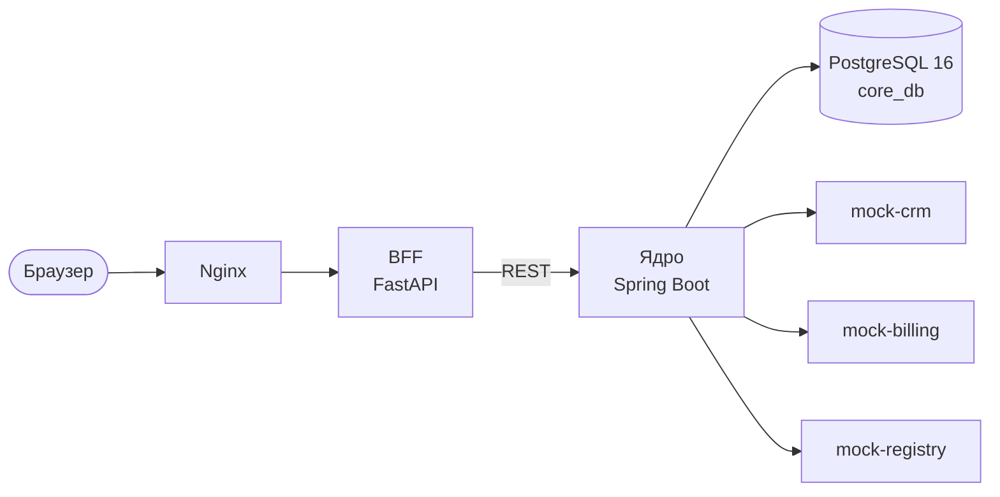

<div align="center">

# B2B-Order-Flow

**Система обработки и согласования заявок на подключение B2B-услуг**

Проектный практикум · заказчик ООО «МТС ДИДЖИТАЛ»


</div>

---

Клиент подаёт заявку, система проверяет данные во внешних системах (CRM, биллинг, справочник клиентов), строит маршрут согласований по правилам, следит за сроками по SLA и хранит историю всех действий. Внешние системы в проекте заменены моками.

## Содержание

- [Возможности](#возможности)
- [Архитектура](#архитектура)
- [Быстрый старт](#быстрый-старт)
- [Конфигурация](#конфигурация)
- [Структура репозитория](#структура-репозитория)
- [Тестирование](#тестирование)
- [Документация](#документация)
- [Статус](#статус)
- [Участие в разработке](#участие-в-разработке)
- [Команда](#команда)
- [Лицензия](#лицензия)

## Возможности

| | |
|---|---|
| **Заявки** | Создание, отправка в работу, карточка с полной историей, архив и экспорт |
| **Маршрутизация** | Маршрут согласований строится по параметрам заявки и пересобирается при изменениях |
| **Согласования** | Параллельные решения юристов, финансов, закупок и руководства |
| **SLA** | Нормативы по этапам, паузы, предупреждения и эскалации, демо-режим «в минутах» |
| **Интеграции** | CRM, биллинг и справочник клиентов с повторами, таймаутами и обработкой сбоев |
| **Уведомления** | События по заявке доставляются в интерфейс в реальном времени |

## Архитектура



Интерфейс обращается к BFF, BFF к ядру по REST. База одна, доступ к ней есть только у ядра. Бизнес-логика, статусы, маршрутизация и SLA живут в ядре. Наружу открыт только Nginx.

| Слой | Технологии |
|---|---|
| Ядро | Java 21, Spring Boot, Flyway |
| BFF | Python 3.12, FastAPI, Pydantic v2, httpx |
| Интерфейс | React |
| База данных | PostgreSQL 16 |
| Моки | WireMock |
| Инфраструктура | Docker Compose, Nginx, GitHub Actions |
| Тесты | JUnit 5, Testcontainers, pytest, Playwright |

## Быстрый старт

**Требования:** Docker с Compose v2, Git. Команды выполняются из корня репозитория.

```bash
cp .env.example .env        # замените все change_me на свои значения
docker compose --env-file .env -f infra/compose.yaml up -d --build
docker compose --env-file .env -f infra/compose.yaml ps
```

Все контейнеры должны перейти в состояние `healthy`. Файл `.env` в git не попадает.

<details>
<summary>Моки на localhost, проверка и остановка</summary>

<br>

Порты моков наружу закрыты. Для отладки их открывает отдельный файл (CRM `8081`, биллинг `8082`, справочник `8083`, только на `127.0.0.1`):

```bash
docker compose --env-file .env -f infra/compose.yaml -f infra/compose.mocks-ports.yaml up -d
curl -H "X-Correlation-Id: test-1" "http://localhost:8081/crm/v1/customers?inn=7725012341"
```

Остановить: `docker compose --env-file .env -f infra/compose.yaml down`. Флаг `-v` удалит том с БД.

Тестовые организации, ИНН и управляемые сбои описаны в [`mocks/README.md`](mocks/README.md), БД и роли в [`infra/README.md`](infra/README.md).

</details>

## Конфигурация

Настройки строго задаются переменными окружения. Шаблон лежит в [`.env.example`](.env.example), рабочие значения в `.env` (в git не попадает).

| Переменная | Назначение |
|---|---|
| `CORE_DB_NAME` | Имя базы данных ядра |
| `CORE_DB_ADMIN_PASSWORD` | Пароль администратора PostgreSQL, нужен только при первом создании БД |
| `CORE_DB_APP_USER`, `CORE_DB_APP_PASSWORD` | Пользователь, под которым работает ядро |
| `CORE_DB_MIGRATION_USER`, `CORE_DB_MIGRATION_PASSWORD` | Пользователь для миграций Flyway |
| `JWT_SECRET` | Секрет подписи JWT |
| `INTERNAL_TOKEN` | Токен вызовов BFF → ядро (`X-Internal-Token`) |
| `SLA_PROFILE` | `PROD` (рабочие часы) или `DEMO` (нормативы в минутах) |

## Структура репозитория

| Папка | Что внутри |
|---|---|
| [`bff-gateway/`](bff-gateway) | Шлюз для интерфейса (FastAPI) |
| [`core-service/`](core-service) | Ядро (Spring Boot) |
| [`ui/`](ui) | Веб-интерфейс (React) |
| [`mocks/`](mocks) | Моки внешних систем (WireMock) |
| [`infra/`](infra) | Docker Compose, скрипты БД (Nginx добавится позже) |
| [`tests/e2e/`](tests/e2e) | Тесты на Playwright: фикстуры, контрактные тесты моков, заготовки сквозных сценариев |
| [`.github/workflows/`](.github/workflows) | CI в GitHub Actions |

## Тестирование

Стратегия описана в `docs/qa/qa-strategy.md` (ветка `docs`). Уровни:

| Уровень | Инструменты |
|---|---|
| Unit | JUnit 5 (ядро), pytest (BFF), React Testing Library (интерфейс) |
| Интеграционные | JUnit 5, Testcontainers, WireMock |
| Сквозные (API и UI) | Playwright на поднятом стенде в Docker Compose |

Контрактные тесты моков и заготовки сквозных сценариев лежат в [`tests/e2e/`](tests/e2e), запуск описан в его README. Команды запуска тестов сервисов появятся вместе с кодом.

В CI (`.github/workflows/ci.yml`) сейчас работают поиск секретов (`gitleaks`), проверка JSON моков и `docker compose config`, а также тесты `tests/e2e` и проверки `ui` (типы, форматирование, unit-тесты). Линтеры и сборка ядра и шлюза добавятся отдельным PR.

## Документация

Документация лежит в ветке `docs`, в папке `docs/`.

| Раздел | Что внутри |
|---|---|
| `docs/tz.md`, `docs/scope.md` | ТЗ и границы проекта |
| `docs/architecture/` | Архитектура, проектирование системы, логирование |
| `docs/system/` | Доменная и статусная модели, маршрутизация, SLA, контракт API, интеграции, нефункциональные требования |
| `docs/business/` | Бизнес-процесс, роли, сценарии, требования к интерфейсу |
| `docs/qa/` | Стратегия тестирования |

## Статус

| Итерация | Сроки | Состояние |
|---|---|---|
| 1. Инициация | 09.10 – 30.10 | Завершена |
| 2. MVP | 31.10 – 04.12 | В работе |
| 3. Контрольная точка | 05.12 – 18.12 | |
| 4. Запуск | 19.12 – 10.01 | |
| 5. Неделя устойчивости | 11.01 – 22.01 | |
| 6. Защита | 23.01 – 29.01 | |

Готово: документация, каркас репозитория, Docker Compose с PostgreSQL, тремя моками, ядром и BFF. В работе: интерфейс, вторая неделя разработки.

## Участие в разработке

- Постоянные ветки: `main` и `dev`. Задачи делаем в коротких ветках от `dev`: `тип/описание`, например `feat/create-request`.
- Типы: `feat` (новая функция), `fix` (исправление), `test` (тесты), `chore` (инфраструктура, сборка, служебные файлы), `docs` (документация). Ветка `docs` занята под документы, поэтому ветки с префиксом `docs/` создать нельзя, берите `chore/`.
- Коммиты по Conventional Commits: `feat: эндпоинт создания заявки`.
- В `dev` и `main` только через PR: один аппрув, автор сам не сливает. В `main` изменения попадают из `dev` на контрольных точках.
- Секреты не коммитим: `.env` в `.gitignore`, пример переменных в `.env.example`.

## Команда

| Роль | Зона ответственности |
|---|---|
| Руководитель проекта, системный аналитик | Архитектура, системная аналитика, координация, ревью |
| Бизнес-аналитик, фронтенд | Бизнес-процессы, роли, сценарии, интерфейс |
| Разработчик ядра | `core-service`, база данных, SLA, интеграции |
| Разработчик API | `bff-gateway`, контракт API, WebSocket |
| DevOps и QA | `infra`, `mocks`, CI, стратегия и автотесты |

## Лицензия

Учебный проект. Лицензия не задана.
