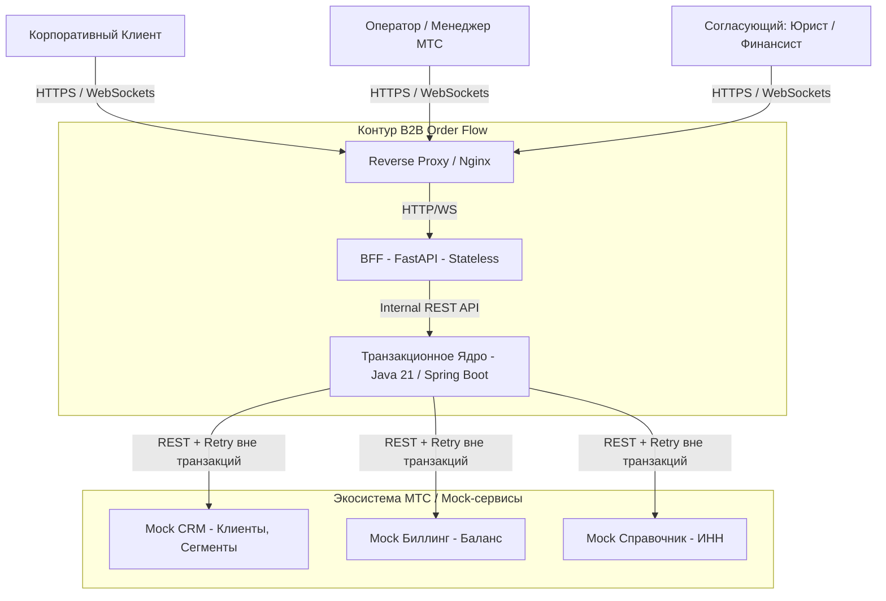
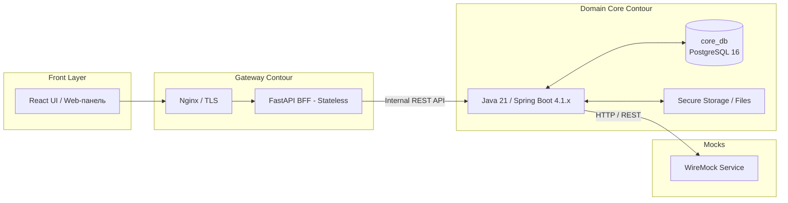

# Системный проект и компонентная архитектура (System Design)

Настоящий документ описывает компонентное устройство, внутреннее разделение ответственности, динамику взаимодействия модулей и инженерные решения по надежности, безопасности и хранению данных системы **B2B Order Flow**.

---

## 1. Верхнеуровневый системный контекст (C4 Context)

Система **B2B Order Flow** выступает связующим звеном между корпоративными клиентами, операционным контуром МТС и внешними справочно-учетными сервисами.

---

## 2. Детализация компонентной архитектуры (Containers)

BFF не имеет собственной БД (stateless) и выступает как API-шлюз и WebSocket-хаб. Все данные хранятся в единой БД ядра.

---

## 3. Декомпозиция модулей транзакционного ядра (Core System Breakdown)

Для обеспечения чистой архитектуры Java-ядро (Java 21) разбито на 8 специализированных функциональных модулей:

1. **Request Engine:** Отвечает за CRUD-операции над заявками, валидацию параметров ШПД, связь с контрагентами и поддержку дочерних заявок.
2. **FSM Router:** Реализует конечный автомат статусов (5 фаз O2A), проверяет доступ ролей к переходам и вычисляет ветку процесса (наличие стройки, необходимость согласований).
3. **SLA Monitor:** Циклический фоновый процесс (`@Scheduled` + `Clock`), рассчитывающий нормы времени на этапы, учитывающий допустимые паузы и генерирующий предупреждения.
4. **Approval Engine:** Формирует задачи для профильных отделов (юристы, финансы, закупки) и агрегирует их решения.
5. **Document & File Engine:** Отвечает за загрузку и бинарное хранение актов/договоров, а также генерацию печатных форм.
6. **Audit & History:** Гарантирует нестираемую фиксацию каждого действия (`AuditLog`).
7. **Integration Gateway:** Изолирует вызовы внешних REST API (CRM, Биллинг) и обеспечивает отказоустойчивость (`Spring Retry` вне транзакций).
8. **Notification Publisher:** Публикует внутренние события для трансляции на FastAPI BFF.

---

## 4. Работа с Базой Данных, JSONB и Брокером

### 4.1. Единая БД и правила JSONB
В системе используется **единая реляционная БД PostgreSQL (`core_db`)** для сохранения строгих ACID-транзакций (изменение статуса, создание задач и аудит должны быть атомарными).

**Правило хранения данных:**
- **Обычные колонки:** Все поля, участвующие в фильтрации, сортировке, JOIN-соединениях и логике SLA (статусы, суммы, даты, ID), хранятся в строго типизированных колонках.
- **JSONB (Postgres):** Используется исключительно для гибких полей, которые читаются целиком (например, «сырые» payload-ответы от Mock-сервисов для истории или произвольные атрибуты услуги, не требующие поиска). Класть в JSONB данные для фильтрации запрещено.

### 4.2. Асинхронность и внедрение Брокера (Путь к развитию)
На этапе MVP система использует синхронный REST и паттерн **Transactional Outbox**:
1. При смене статуса Java-ядро пишет уведомление в БД в рамках одной транзакции.
2. После коммита (`@TransactionalEventListener`) отправляется сигнал на FastAPI.

В архитектуру заложена возможность **внедрения брокера сообщений (RabbitMQ или Kafka)** при росте нагрузки. Брокер будет использоваться для:
- Отправки уведомлений (разгрузка основного потока).
- Выполнения тяжелых задач (генерация PDF-документов).
- Взаимодействия с внешними системами (интеграции по паттерну Saga). 

---

## 5. Конфиденциальность данных и безопасность

- **Категории данных:** Персональные данные, финансовые параметры (скидки, CAPEX), юридические реквизиты и аудит.
- **Локализация:** Все конфиденциальные данные хранятся строго в `core_db`. BFF не имеет прямого доступа к БД.
- **Безопасность:** БД ядра находится в закрытом сетевом контуре Docker. Доступ к ней имеет только контейнер Spring Boot. Авторизация на уровне API — Spring Security + JWT (RBAC).
- **Внешние вызовы:** Вызовы Mock CRM и Биллинга осуществляются **строго до открытия транзакции**, чтобы избежать блокировки пула соединений Hikari при сбоях сетей.

---

## 6. Сводный технологический стек по компонентам

| Компонент | Технологии / Библиотеки | Назначение |
| --- | --- | --- |
| **Reverse Proxy** | Nginx | Терминация TLS, статика UI, rate limit |
| **BFF** | Python 3.12, FastAPI, Pydantic v2, `httpx` | Единая точка входа, валидация DTO, проксирование |
| **Real-time Push** | WebSockets (FastAPI) | Мгновенная доставка уведомлений в UI |
| **Domain Core** | **Java 21**, Spring Boot 4.1.x, Spring Data JPA | Бизнес-логика, FSM, SLA, транзакции, аудит |
| **Единая БД & Миграции** | PostgreSQL 16 (`core_db`), Flyway | Хранение сущностей, JSONB для гибких полей |
| **Интеграции & Retry** | Spring RestClient, Spring Retry | Безопасный вызов внешних сервисов |
| **Тестирование & Моки** | JUnit 5, Testcontainers, WireMock, Playwright | Unit, интеграционные и E2E тесты |
| **Инфраструктура** | Docker, Docker Compose, GitHub Actions | Контейнеризация и автоматизация CI/CD |
| **Брокер (Будущее)** | RabbitMQ / Kafka | Асинхронность, Outbox, тяжелые задачи |