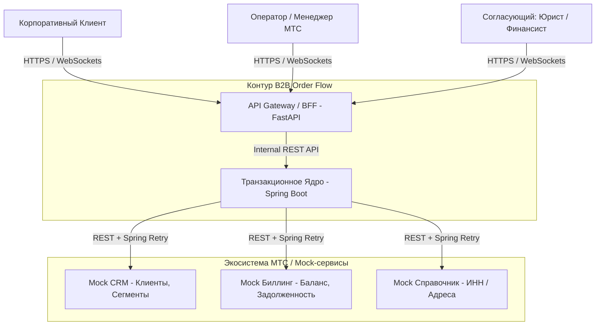
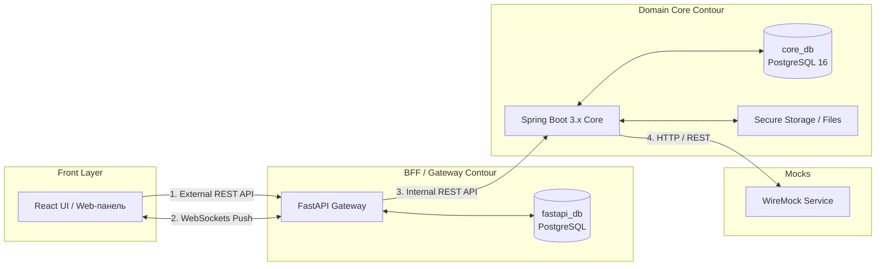
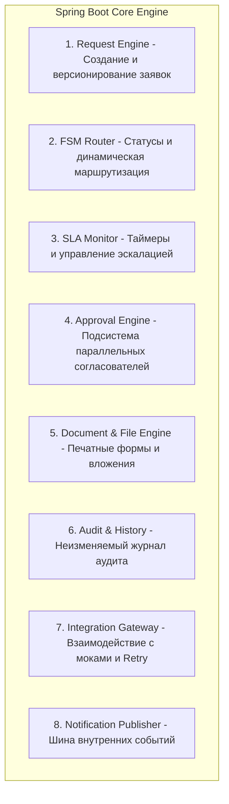
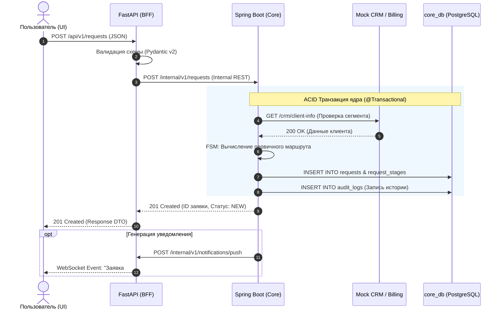

# Системный проект и компонентная архитектура (System Design)

Настоящий документ описывает компонентное устройство, внутреннее разделение ответственности, динамику взаимодействия модулей и инженерные решения по надежности, безопасности и хранению данных системы **B2B Order Flow**.

---

## 1. Верхнеуровневый системный контекст (C4 Context)

Система **B2B Order Flow** выступает связующим звеном между корпоративными клиентами, операционным контуром МТС и внешними справочно-учетными сервисами.

---

## 2. Детализация компонентной архитектуры (Containers)

Система построена на принципах **гибридной микросервисной архитектуры** с разграничением слоев ответственности (BFF vs Core) и соблюдением паттерна **Database-per-Service**.

---

## 3. Декомпозиция модулей транзакционного ядра (Core System Breakdown)

Для обеспечения чистой архитектуры и изоляции контекстов Java-ядро разбито на 8 специализированных функциональных модулей:

### Назначение модулей:

1. **Request Engine:** Отвечает за CRUD-операции над заявками, валидацию параметров ШПД, связь с контрагентами и поддержку дочерних заявок.
2. **FSM Router:** Реализует конечный автомат статусов (5 фаз O2A), проверяет доступ ролей к переходам и вычисляет ветку процесса (наличие стройки, необходимость согласований).
3. **SLA Monitor:** Циклический фоновый процесс (`@Scheduled`), рассчитывающий нормы времени на этапы, учитывающий допустимые паузы и генерирующий предупреждения при 25% остатка времени.
4. **Approval Engine:** Формирует задачи для профильных отделов (юристы, финансы, закупки, спец-согласования) и агрегирует их решения.
5. **Document & File Engine:** Отвечает за загрузку и бинарное хранение актов/договоров, а также подстановку данных заявки в печатные шаблоны.
6. **Audit & History:** Гарантирует нестираемую фиксацию каждого действия (`AuditLog`) с указанием автора, timestamp и старого/нового значения.
7. **Integration Gateway:** Изолирует вызовы внешних REST API (CRM, Биллинг) и обеспечивающий отказоустойчивость при помощи **Spring Retry**.
8. **Notification Publisher:** Публикует `Spring Events` для трансляции событий на FastAPI BFF и последующего push-уведомления в UI.

---

## 4. Динамика взаимодействия: Сквозной Sequence-поток (SC-01 / SC-03)

Ниже представлена диаграмма последовательности вызовов при создании заявки и автоматической обработке статуса:

---

### 5. Конфиденциальность данных и локализация

* **Категории данных:** Персональные данные (ФИО, контакты), финансовые параметры (коммерческие скидки, индивидуальные тарифы, CAPEX на стройку), юридические реквизиты (ИНН/ОГРН, тексты договоров) и таблицы аудита (`AuditLog`).
* **Локализация:** Все конфиденциальные данные хранятся **строго в `core_db` (БД транзакционного ядра)**.
* **Безопасность:** БД ядра находится в закрытом сетевом контуре Docker (Private VPC/Network) без внешних портов наружу. Доступ к ней имеет только контейнер Spring Boot. Авторизация на уровне API выполняется по стандартам JWT + Spring Security (RBAC).

---

### 6. Локализация SLA, истории и уведомлений

* **SLA-контроль:** Находится в Java-ядре. Фоновый сервис (`@Scheduled` + `Clock`) циклически запрашивает активные этапы, рассчитывает остаток времени и генерирует события эскалации при остатке $\le 25\%$.
* **История изменений:** Таблица `audit_logs` в `core_db`. Запись производится атомарно в той же ACID-транзакции, что и изменение самой заявки.
* **Уведомления:** Генерируются ядром и передаются на FastAPI BFF, удерживающий активные WebSocket-сессии с клинетами и операторами.

---

### 7. Обеспечение согласованности данных при сбоях (ACID & Failover)

* **Транзакционность:** Аннотация `@Transactional` в Java-ядре гарантирует откат всей операции при любых ошибках (откат смены статуса, создания задачи и записи аудита).
* **Сбои внешних систем (Mock-сервисы):** Интеграционный слой ядра обернут в паттерн **Spring Retry** (экспоненциальная задержка при повторных попытках). При недоступности мока заявка переходит во временный статус ожидания интеграции с фиксированием ошибки, исключая повреждение данных.

---

## 8. Сводный технологический стек по компонентам

| Компонент | Технологии / Библиотеки | Назначение |
| --- | --- | --- |
| **API Gateway / BFF** | Python 3.11, FastAPI, Pydantic v2, Uvicorn, `httpx` | Единая точка входа, валидация DTO, проксирование |
| **Real-time Push** | WebSockets (FastAPI) | Мгновенная доставка уведомлений в UI |
| **Gateway DB** | PostgreSQL 16 (`fastapi_db`) | Кэш сессий, временные контексты, WS-клиенты |
| **Domain Core** | Java 21, Spring Boot 3.x, Spring Data JPA, Spring Security | Бизнес-логика, FSM, SLA, транзакции, аудит |
| **Core DB & Migrations** | PostgreSQL 16 (`core_db`), Flyway | Хранение сущностей домена, миграции схем |
| **Интеграции & Retry** | Spring WebClient / RestTemplate, Spring Retry | Безопасный вызов внешних сервисов |
| **Тестирование & Моки** | JUnit 5, Testcontainers, WireMock, Playwright | Unit, интеграционные и E2E тесты |
| **Инфраструктура** | Docker, Docker Compose, GitHub Actions | Контейнеризация и автоматизация CI/CD |
