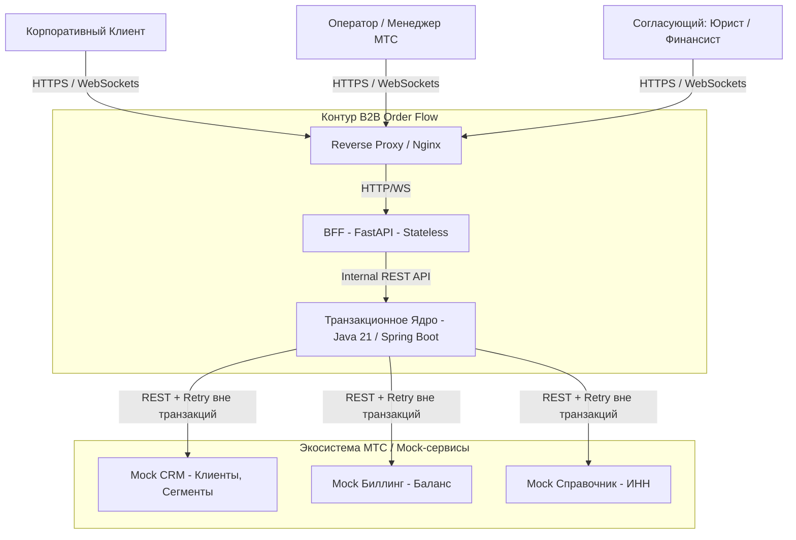
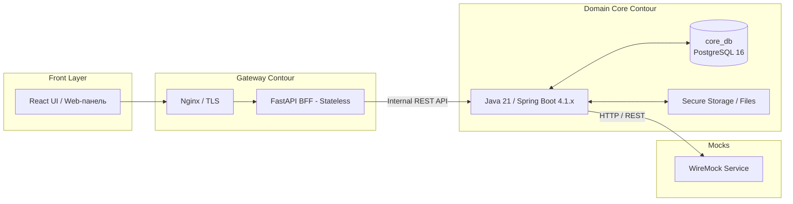

# Системный проект и компонентная архитектура (System Design)

Настоящий документ описывает компонентное устройство, внутреннее разделение ответственности, динамику взаимодействия модулей и инженерные решения по надежности, безопасности и хранению данных системы **B2B Order Flow**.

---

## 1. Верхнеуровневый системный контекст (C4 Context)

Система **B2B Order Flow** выступает связующим звеном между корпоративными клиентами, операционным контуром МТС и внешними справочно-учетными сервисами.

---

## 2. Детализация компонентной архитектуры (Containers)

BFF не имеет собственной БД (stateless) и выступает как API-шлюз и WebSocket-хаб. Все данные хранятся в единой БД ядра.

---

## 3. Декомпозиция модулей транзакционного ядра (Core System Breakdown)

Для обеспечения чистой архитектуры Java-ядро (Java 21) разбито на 9 специализированных функциональных модулей:

1. **Request Engine:** Отвечает за CRUD-операции над заявками, валидацию параметров ШПД, связь с контрагентами и поддержку дочерних заявок.
2. **FSM Router:** Реализует конечный автомат статусов по таблице переходов ([status-model.md](../system/status-model.md)), проверяет роль, условие и версию при каждом переходе и строит маршрут по правилам [routing-rules.md](../system/routing-rules.md): предварительный и окончательный, с пересборкой при изменении параметров.
3. **SLA Monitor:** Циклический фоновый процесс (`@Scheduled` + `Clock`) по правилам [sla.md](../system/sla.md): нормативы этапов в профилях PROD и DEMO, рабочий календарь, паузы по закрытому справочнику с журналом и пределом, предупреждения, нарушения, эскалации и контрольные сроки заявки.
4. **Approval Engine:** Формирует задачи для профильных отделов (юристы, финансы, закупки) и управленческого согласования, агрегирует их решения и сохраняет снимок параметров каждого решения, чтобы при пересборке маршрута сохранять решения, на которые изменение не повлияло.
5. **Document & File Engine:** Отвечает за загрузку и бинарное хранение актов, договоров и протоколов разногласий, а также за формирование PDF-досье заявки для архива. Вложения версионируются (без перезаписи); скачивание — только через ядро с проверкой прав и записью в аудит. Хранилище — раздел 5.1.
6. **Audit & History:** Гарантирует нестираемую фиксацию каждого действия (`AuditLog`): пользователю приложения в БД выданы только `INSERT` и `SELECT` на журнал.
7. **Integration Gateway:** Изолирует вызовы внешних REST API (CRM, Биллинг) и обеспечивает отказоустойчивость (`Spring Retry` вне транзакций).
8. **Notification Publisher:** Сохраняет уведомления (`notification`) в одной транзакции с бизнес-изменением и передаёт сигнал на FastAPI BFF. WebSocket — только сигнал, источник данных — REST.
9. **Identity & Access:** Пользователи, компании-клиенты, роли в компании и в процессе, подтверждение компаний и единая политика доступа (изоляция по компании, проверка активной роли, разделение обязанностей).

---

## 4. Работа с Базой Данных, JSONB и Брокером

### 4.1. Единая БД и правила JSONB
В системе используется **единая реляционная БД PostgreSQL (`core_db`)** для сохранения строгих ACID-транзакций (изменение статуса, создание задач и аудит должны быть атомарными).

**Правило хранения данных:**
- **Обычные колонки:** Все поля, участвующие в фильтрации, сортировке, JOIN-соединениях и логике SLA (статусы, суммы, даты, ID), хранятся в строго типизированных колонках.
- **JSONB (Postgres):** Используется исключительно для гибких полей, которые читаются целиком (например, «сырые» payload-ответы от Mock-сервисов для истории или произвольные атрибуты услуги, не требующие поиска). Класть в JSONB данные для фильтрации запрещено.

### 4.2. Асинхронность и внедрение Брокера (Путь к развитию)
На этапе MVP система использует синхронный REST и хранимые уведомления (упрощённый Transactional Outbox, см. [architecture.md](architecture.md), раздел 4):
1. При смене статуса Java-ядро пишет уведомление в БД в рамках одной транзакции.
2. После коммита (`@TransactionalEventListener`) ядро отправляет сигнал на FastAPI; необработанные записи (`published_at IS NULL`) доотправляет фоновая задача. При реконнекте интерфейс перечитывает непрочитанные уведомления по REST.

В архитектуру заложена возможность **внедрения брокера сообщений (RabbitMQ)** при росте нагрузки. Брокер будет использоваться для:
- Отправки уведомлений (разгрузка основного потока).
- Выполнения тяжелых задач (генерация PDF-документов).
- Взаимодействия с внешними системами (интеграции по паттерну Saga). 

---

## 5. Конфиденциальность данных и безопасность

- **Категории данных:** Персональные данные, финансовые параметры (скидки, CAPEX), юридические реквизиты и аудит.
- **Локализация:** Все конфиденциальные данные хранятся строго в `core_db`. BFF не имеет прямого доступа к БД.
- **Безопасность:** БД ядра находится в закрытом сетевом контуре Docker. Доступ к ней имеет только контейнер Spring Boot. Авторизация на уровне API — Spring Security + JWT (RBAC).
- **Изоляция компаний:** `company_id` обязателен во всех сущностях заявки; фильтр накладывается единой политикой доступа ядра. Негативные тесты на каждый эндпоинт: чужая компания, удалённый сотрудник, неверная активная роль (EC-16, EC-17, EC-18). Row-Level Security в Postgres — опциональный второй рубеж.
- **Документы и экспорт:** документы и отчёты отдаются только через ядро в рамках компании пользователя; каждое скачивание и экспорт пишется в аудит.
- **Периметр:** наружу открыт только Nginx; порты БД и ядра, Actuator и Swagger ядра закрыты. Вызовы BFF → ядро аутентифицируются межсервисным секретом; ответы ядра с данными клиентов в логи BFF не пишутся.

### 5.1. Хранение файлов

| Параметр | Решение |
|---|---|
| Где лежат | Отдельный том Docker `core-files`, смонтированный только в контейнер ядра (`/var/lib/b2b/files`) |
| Почему не в БД | Бинарные данные раздувают дамп и усложняют бэкап; для прототипа том проще и прозрачнее |
| Почему не S3/MinIO | Лишний сервис в Compose без выигрыша на этих объёмах. Переход на S3 затрагивает только `storage_key` и один адаптер |
| Структура путей | `<год>/<месяц>/<requestId>/<attachmentId>` — непрозрачный ключ, имя файла хранится отдельно в БД |
| Доступ | Только через `GET /attachments/{id}/content` ядра с проверкой прав; Nginx каталог файлов не раздаёт |
| Целостность | `sha256` считается при загрузке и хранится в `attachment`; проверяется при скачивании |
| Версии | Новая загрузка создаёт новую версию (`version_no`, `supersedes_id`); файлы не перезаписываются и не удаляются |
| Лимиты | 10 МБ на файл, 20 вложений на заявку, типы `pdf`, `docx`, `xlsx`, `jpg`, `png`; тип проверяется по содержимому, а не по расширению ([nfr.md](../system/nfr.md), раздел 7) |
| Бэкап | Том архивируется вместе с дампом БД ([nfr.md](../system/nfr.md), раздел 6) |
| Файлы экспорта | Отдельный том `core-exports`, срок жизни 24 часа, одноразовые ссылки |

Записи в БД и файлы на томе могут разойтись при сбое: ядро сначала пишет файл, затем запись в БД, поэтому возможен «осиротевший» файл без записи (безвреден, подчищается фоновой задачей), но не запись без файла.
- **Внешние вызовы:** Вызовы Mock CRM и Биллинга осуществляются **строго до открытия транзакции**, чтобы избежать блокировки пула соединений Hikari при сбоях сетей.

---

## 6. Сводный технологический стек по компонентам

| Компонент | Технологии / Библиотеки | Назначение |
| --- | --- | --- |
| **Reverse Proxy** | Nginx | Терминация TLS, статика UI, rate limit |
| **BFF** | Python 3.12, FastAPI, Pydantic v2, `httpx` | Единая точка входа, валидация DTO, проксирование |
| **Real-time Push** | WebSockets (FastAPI) | Мгновенная доставка уведомлений в UI |
| **Domain Core** | **Java 21**, Spring Boot 4.1.x, Spring Data JPA | Бизнес-логика, FSM, SLA, транзакции, аудит |
| **Единая БД & Миграции** | PostgreSQL 16 (`core_db`), Flyway | Хранение сущностей, JSONB для гибких полей |
| **Интеграции & Retry** | Spring RestClient, Spring Retry | Безопасный вызов внешних сервисов |
| **Тестирование & Моки** | JUnit 5, Testcontainers, WireMock, Playwright | Unit, интеграционные и E2E тесты |
| **Инфраструктура** | Docker, Docker Compose, GitHub Actions | Контейнеризация и автоматизация CI/CD |
| **Брокер (Будущее)** | RabbitMQ | Асинхронность, полноценный Outbox, тяжелые задачи |

---

## 7. Связанные документы

- [architecture.md](architecture.md) — подход, транспорт, обработка сбоев, стек;
- [domain-model.md](../system/domain-model.md) — сущности и ограничения;
- [status-model.md](../system/status-model.md) — статусы, этапы, переходы;
- [routing-rules.md](../system/routing-rules.md) — правила маршрутизации;
- [sla.md](../system/sla.md) — сроки, паузы, эскалации.
