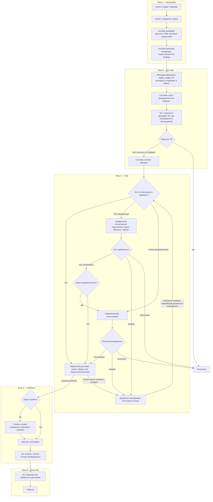
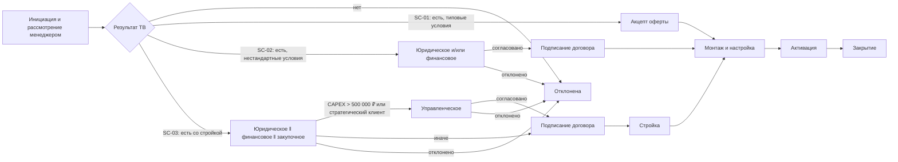

# Бизнес-процесс обработки заявки

## 1. Назначение

Документ описывает, как заявка на подключение ШПД для юрлица или ИП проходит через учебный прототип B2B-Order-Flow: от создания заявки представителем клиента до активации услуги и закрытия заявки. Процесс разбит на пять фаз: **инициация, pre-sale, sale, fulfillment, post-sale**.

Документ — вход для:
- [статусной модели](../system/status-model.md) — статусы и переходы внутри фаз и между ними;
- [правил маршрутизации](../system/routing-rules.md) — где маршрут строится и где уточняется;
- [SLA](../system/sla.md) — какие этапы контролируются, где пауза и эскалация;
- [уведомлений](../system/notifications.md) — события процесса;
- [UI-требований](ui-requirements.md) — что делает каждая роль в каждой фазе.

Основа:
- [research-b2b.md](research-b2b.md) — типовые этапы подключения (раздел 2.3), кейс МТС, TM Forum;
- [scenarios.md](scenarios.md) — SC-00…SC-03 и EC-01…EC-19; сценарии — конкретные прохождения этого процесса;
- [roles.md](roles.md) — роли, коды, матрица действий, правила взаимодействия;
- отраслевые источники — раздел 16.

Статусы — рабочие, по [scenarios.md](scenarios.md), раздел 2.2. Финальные коды и переходы задаёт [статусная модель](../system/status-model.md).

## 2. Границы процесса

| Граница | Описание |
|---|---|
| Начало | Представитель клиента создаёт черновик заявки |
| Успешный конец | Менеджер подтвердил подписание акта клиентом, заявка «Закрыта» |
| Неуспешный конец | «Отклонена» (нет ТВ или отклонено согласование) или «Отменена» (до активации, по правилам раздела 11) |
| Предусловие | Компания-клиент зарегистрирована и подтверждена (SC-00) |
| Объект | Одна заявка = одна компания-клиент + один адрес; новое подключение ШПД |

**Предусловие SC-00 (не фаза процесса).** Представитель регистрируется на платформе и регистрирует компанию (ИНН, КПП, ОГРН, юр. адрес). Системный администратор сверяет ИНН со справочником клиентов и подтверждает компанию. Владелец добавляет сотрудников по логину и отмечает роли. Пока компания не подтверждена, создать заявку нельзя (EC-14).

**Вне прототипа:**
- интерфейс компании с заявками и сотрудниками; несколько компаний у пользователя; приглашения по ссылке;
- участники конкретной заявки (`RequestMember`), наблюдатели, внешние представители;
- делегирование согласований;
- изменение заявки в работе, кроме доработки после возврата;
- биллинг и начало тарификации;
- техподдержка и обслуживание после подключения;
- переносы, изменения услуги, расторжение договора.

## 3. Участники

Полное описание ролей и прав — [roles.md](roles.md).

| Участник | Код | Фазы | Что делает в процессе |
|---|---|---|---|
| Представитель клиента | `CLIENT_REQUESTER`, `CLIENT_OWNER` | 1, 3, 5; в 2 и 4 видит статус | Создаёт и отправляет заявку, отвечает на комментарии, принимает условия оферты, сообщает о проблеме до приёмки, отменяет заявку или запрашивает отмену (раздел 11) |
| Система | — | 1–5 | Проверка данных, назначение менеджера, маршрут, этапы, статусы, SLA, уведомления, история |
| Менеджер по продажам | `SALES_MANAGER` | 2, 3, 5 | Коммерческие условия, отправка в работу, доработка, заключение договора, сумма затрат при отмене, закрытие |
| Технический специалист | `TECH_SPECIALIST` | 2 | Проверка ТВ, оценка CAPEX и срока стройки, запрос обследования |
| Юрист | `LAWYER` | 3 | Юридическое согласование |
| Финансовый контролёр | `FINANCE_CONTROLLER` | 3; при отмене | Финансовое согласование; подтверждение суммы затрат при отмене по соглашению |
| Специалист по закупкам | `PROCUREMENT_SPECIALIST` | 3 | Закупочное согласование |
| Руководитель B2B | `B2B_HEAD` | 3; сквозное | Управленческое согласование, второй уровень эскалации, утверждение отмены по инициативе оператора после заключения договора |
| Инженер-монтажник | `ENGINEER` | 4 | Фиксирует стройку, монтаж и настройка, тест, активация |
| Координатор заявок | `COORDINATOR` | 1–5 | Очереди и назначения, пауза SLA по закрытому списку причин, первый уровень эскалации, служебная отмена до заключения договора |
| Подрядчик | вне системы | 4 | Стройка; его работу фиксирует инженер |
| Mock CRM, биллинг, справочник клиентов | внешние системы | 1 | Сегмент, закреплённый менеджер, госзаказчик, задолженность |

`ADMIN` в обработке заявки не участвует: подтверждает компании (SC-00), ведёт справочники и пороги.

## 4. Обзор фаз

| Фаза | Цель | Основные участники | Рабочие статусы | Вход | Выход / контрольная точка |
|---|---|---|---|---|---|
| 1. Инициация | Принять заявку, проверить клиента, назначить владельца | Клиент, Система, Координатор | Черновик, Проверка данных | Компания подтверждена | **G1** Менеджер назначен |
| 2. Pre-sale | Зафиксировать условия и подтвердить ТВ | Менеджер, Тех. специалист, Система | У менеджера, Проверка ТВ | G1 | **G2** ТВ подтверждена, маршрут окончательный |
| 3. Sale | Согласовать сделку внутри оператора и заключить договор с клиентом | Юрист, Финансы, Закупки, Руководитель B2B, Менеджер, Клиент | На согласовании, На доработке, Подписание договора | G2 | **G3** Сделка согласована, договор заключён |
| 4. Fulfillment | Построить, подключить и запустить услугу | Инженер (+ подрядчик) | В исполнении | G3 | **G4** Услуга активирована |
| 5. Post-sale | Сдать услугу клиенту и закрыть заявку | Менеджер, Клиент | Услуга активирована → Закрыта | G4 | **G5** Заявка закрыта |

Финалы вне основного потока: «Отклонена» (фазы 2–3), «Отменена» (фазы 1–4). Правила отмены зависят от **уровня обязательств** сторон (раздел 11): до договора, после договора, после начала работ, после активации.

**Почему такое разбиение:**
- **Инициация** = квалификация клиента. В eTOM подготовка предложения начинается только после одобрения процесса Qualify Customer ([TM Forum MODA](https://tmforum.org/MODA/EARoot/EA5/EA1/EA1/EA6989.htm)).
- **Pre-sale** = ТВ до коммерческого решения. Salesforce отсекает адреса вне покрытия «до формирования КП» ([Salesforce, 2022](https://www.salesforce.com/blog/lead-to-order-automation-communications-providers/)). ServiceNow проверяет ТВ (TMF645) до отправки заказа ([ServiceNow](https://www.servicenow.com/docs/r/HGDW_sLOfs0QXhKu64QAng/RGYRFi~q3r_PtIlC0~_Niw)).
- **Sale** = внутреннее согласование сделки. В eTOM Negotiate Sales/Contract продажа завершается согласованием условий, уровня сервиса, цены и скидок ([TM Forum Frameworx](https://www.tmforum.org/Browsable_HTML_Frameworx_R16.5/main/etomprocess1127.htm)). У ServiceNow согласования идут до подтверждения КП и договора ([ServiceNow](https://www.servicenow.com/docs/r/telecom-media-technology/somt-workflow.html)).
- **Fulfillment** = eTOM Service Configuration & Activation и Resource Provisioning: выделение, установка, настройка, активация, тестирование ([TIBCO, eTOM и SID](https://docs.tibco.com/pub/fp/3.8.1/doc/html/fp_user_guide/c_eTOM_and_SID.htm)).
- **Post-sale** = сдача услуги. Дата приёмки клиентом (RFS date) запускает выставление счетов ([Law Insider, Handover](https://www.lawinsider.com/clause/handover/_9)). Биллинг и сопровождение в eTOM — отдельные вертикали, поэтому они вне прототипа.

Отмена возможна из любой фазы до отметки «Услуга активирована» и на схеме не показана — правила по уровням обязательств в разделе 11.

## 5. Фаза 1. Инициация

**Цель:** принять заявку от клиента, проверить клиента во внешних системах и назначить владельца заявки со стороны оператора.

**Вход:** компания-клиент подтверждена (SC-00), у представителя роль `CLIENT_REQUESTER` или `CLIENT_OWNER`.

| № | Кто | Действие | Результат / статус |
|---|---|---|---|
| 1 | Представитель клиента | Создаёт заявку: адрес, скорость, желаемая дата, контактное лицо, пожелания по договору, комментарий | «Черновик» |
| 2 | Представитель клиента | Отправляет заявку оператору; система проверяет обязательные поля и формат | «Проверка данных» |
| 3 | Система | Запрашивает mock CRM, биллинг, справочник клиентов: сегмент, закреплённый менеджер, госзаказчик, задолженность | Данные подтянуты в заявку |
| 4 | Система | Назначает заявку закреплённому в CRM менеджеру; если его нет — ставит в очередь менеджеров | Менеджер уведомлён / очередь уведомлена |
| 5 | Менеджер | Если заявка в очереди — берёт её в работу | «У менеджера» |

**Выход (G1):** у заявки есть менеджер, данные клиента получены, статус «У менеджера».

**Исключения:**
- EC-02 — обязательные поля не заполнены или формат неверен: отправить заявку нельзя.
- EC-12 — по компании и адресу уже есть незакрытая заявка: предупреждение без запрета; дубль отменяет координатор.
- EC-10 — внешняя система недоступна: повтор запросов, затем заявка ждёт в «Проверке данных» с пометкой об ошибке, координатор уведомлён. Заявка не отклоняется.
- EC-19 — нет закреплённого менеджера и очередь пуста: предупреждение очереди и координатору, координатор назначает менеджера.
- EC-03 — у клиента задолженность: процесс идёт дальше, в маршрут добавится финансовое согласование.

## 6. Фаза 2. Pre-sale

**Цель:** зафиксировать коммерческие условия, подтвердить техническую возможность подключения и получить окончательный маршрут.

**Вход:** G1.

| № | Кто | Действие | Результат / статус |
|---|---|---|---|
| 1 | Менеджер | Проверяет заявку; неточности уточняет у клиента комментарием и исправляет сам | Данные заявки корректны |
| 2 | Менеджер | Фиксирует тариф (типовой / индивидуальная цена), скидку, тип договора; отправляет в работу | Коммерческие условия зафиксированы |
| 3 | Система | Строит **предварительный маршрут** по параметрам: скорость, тариф и скидка, договор, госзаказчик, задолженность, сегмент | План этапов виден в карточке |
| 4 | Система | Создаёт этап «Проверка ТВ» в очереди технических специалистов, запускает SLA | «Проверка ТВ» |
| 5 | Тех. специалист | Берёт этап; если ТВ неочевидна — запрашивает обследование объекта | — |
| 6 | Тех. специалист | Вносит результат ТВ: **есть** / **есть со стройкой** (CAPEX, срок) / **нет** (причина) | Результат в заявке и истории |
| 7 | Система | «Нет» → автоматический отказ. Иначе **уточняет маршрут**: стройка добавляет закупочное и финансовое согласования, а при CAPEX > 500 000 ₽ — управленческое | «Отклонена» или переход в фазу 3 |

**Выход (G2):** ТВ подтверждена («есть» или «есть со стройкой»), маршрут окончательный, создан первый этап следующей фазы.

**Исключения:**
- EC-02 — менеджер находит ошибку в данных: уточняет у клиента комментарием и исправляет сам, клиенту на доработку не возвращает.
- EC-01 — ТВ «нет»: «Отклонена», клиент может создать новую заявку на основе отклонённой.
- EC-04 — стройка у «стандартной» заявки: маршрут пересобирается, заявка идёт как крупная.
- EC-06, EC-07 — этап ТВ не взят или просрочен: предупреждение, эскалация (раздел 10).

**Контрольный срок ТВ.** Помимо SLA этапа система отслеживает срок «отправка заявки → результат ТВ»: не более **30 календарных дней**. Это верхняя граница из Правил оказания услуг связи по передаче данных (ПП РФ № 2606, п. 24: проверка ТВ — не более 1 месяца; при отсутствии ТВ — письменный отказ не позднее 10 дней, п. 26). При ТВ «нет» клиент получает уведомление с причиной сразу. Приближение к 30 дням — уведомление координатору (раздел 10).

Проверка ТВ «по базе» может разойтись с выездом на объект: в клиентском кейсе 2025 года оператор подтвердил ТВ, а приехавший техник установил, что подключение невозможно ([T—Ж, 2025](https://t-j.ru/business-story-internet/)). Поэтому техническому специалисту оставлен запрос обследования.

## 7. Фаза 3. Sale

**Цель:** получить внутренние согласования сделки, которых требует маршрут, и заключить договор с клиентом. Для стандартной заявки согласований нет — фаза сводится к акцепту оферты.

**Вход:** G2.

### 7.1. Согласования

Шаги выполняются, если в маршруте есть хотя бы одно согласование; иначе — сразу 7.2.

| № | Кто | Действие | Результат / статус |
|---|---|---|---|
| 1 | Система | Создаёт **параллельно** этапы профильных согласований из маршрута (юридическое, финансовое, закупочное) в очередях ролей, запускает SLA каждого. Если профильных согласований в маршруте нет, а управленческое есть (стратегический клиент на типовых условиях) — сразу шаг 3 | «На согласовании» |
| 2 | Юрист / Финансовый контролёр / Специалист по закупкам | Берут свои этапы; решают: **согласовать**, **вернуть на доработку** или **отклонить** (возврат и отклонение — с причиной) | Решение и комментарий в истории |
| 3 | Система | Все профильные согласовали → создаёт этап «Управленческое согласование», если он в маршруте (стратегический клиент или CAPEX > 500 000 ₽) | «На согласовании» |
| 4 | Руководитель B2B | Видит все решения и комментарии; согласует, возвращает или отклоняет | Решение в истории |
| 5 | Система | Все согласования маршрута пройдены → этап «Подписание договора» | 7.2 |

**Возврат на доработку** (SC-02 A1, [roles.md](roles.md), 8.3):

| № | Кто | Действие | Результат / статус |
|---|---|---|---|
| 1 | Согласующий | Возвращает заявку с комментарием, что исправить | «На доработке», SLA этапа на паузе, менеджер уведомлён |
| 2 | Менеджер | При необходимости запрашивает данные у клиента комментарием; исправляет заявку; отправляет повторно | Заявка возвращается на тот же этап, SLA возобновлён |
| 3 | Система | Если изменились параметры маршрута — пересобирает маршрут; ненужные согласования отменяет (SC-02 A2). Решения других согласующих сохраняются, если не менялись влияющие на них параметры | «На согласовании» |

**Отклонение:** одного «отклонить» достаточно — заявка «Отклонена», незавершённые согласования отменяются, их исполнители, менеджер и клиент уведомлены (EC-05, SC-03 A1).

Параллельный запуск обоснован тем, что при последовательных согласованиях время цикла равно сумме, а при параллельных — максимуму ([Kognitos, 2026](https://www.kognitos.com/blog/deal-desk/)).

### 7.2. Подписание договора

В eTOM продажа завершается подписанным договором ([TM Forum Frameworx](https://www.tmforum.org/Browsable_HTML_Frameworx_R16.5/main/etomprocess1127.htm)), поэтому договор — обязательный этап перед исполнением. Клиент видит итоговые условия: адрес, скорость, тариф и цену, тип договора.

| № | Кто | Действие | Результат / статус |
|---|---|---|---|
| 1 | Система | Создаёт этап «Подписание договора» для менеджера заявки, показывает клиенту итоговые условия | «Подписание договора» |
| 2а | Представитель клиента | **Оферта** (типовые условия): нажимает «Принять условия» — акцепт оферты в системе | Договор заключён |
| 2б | Менеджер | **Типовой договор или договор по форме клиента**: готовит договор и отправляет клиенту, отмечает «Договор отправлен» | SLA этапа на паузе «Ожидание подписи клиента» |
| 3б | Менеджер | Получает подписанный договор, отмечает «Договор заключён»: номер, дата | Договор заключён |
| 4 | Система | Фиксирует событие «Договор заключён» → **уровень обязательств 1** (раздел 11), переход в фазу 4 | G3 |

**Если клиент не согласен с условиями:**
- просит изменить условия → менеджер вносит изменения как при доработке; если изменились параметры маршрута — маршрут пересобирается, нужные согласования проходят заново (SC-02 A2);
- отказывается от подключения → клиент отменяет заявку в одностороннем порядке, договора ещё нет (уровень 0).

Оплата счёта по оферте (как в кейсе МТС) — функция биллинга, вне прототипа.

**Выход (G3):** все согласования маршрута пройдены и договор заключён.

**Исключения:**
- EC-05 — одно из параллельных согласований отклонено.
- EC-13 — повторный возврат: число возвратов не ограничено, каждая итерация в истории.
- EC-18 — менеджер заявки с ролью согласующего не может согласовать свою заявку; этап берёт другой пользователь роли.
- EC-07 — согласующий не решил в срок: эскалация, автоматического отказа нет.
- EC-25 — клиент долго не подписывает договор: пауза ограничена предельным сроком (раздел 10.1).

## 8. Фаза 4. Fulfillment

**Цель:** построить линию (если нужно), смонтировать оборудование, настроить и запустить канал.

**Вход:** G3.

| № | Кто | Действие | Результат / статус |
|---|---|---|---|
| 1 | Система | Создаёт первый этап исполнения в очереди инженеров: «Стройка» (только при ТВ «есть со стройкой») или «Монтаж и настройка» | «В исполнении» |
| 1а | Инженер | Берёт первый этап исполнения в работу | Событие «Работы начаты» → **уровень обязательств 2** (раздел 11) |
| 2 | Инженер | Фиксирует завершение стройки, выполненной подрядчиком | Создан этап «Монтаж и настройка» |
| 3 | Инженер | Берёт этап, выполняет монтаж и настройку, отмечает выполненным | Создан этап «Активация» |
| 4 | Инженер | Тестирует канал, отмечает «Услуга активирована» | «Услуга активирована» |

**Выход (G4):** услуга активирована — аналог Ready for Service: оператор передаёт работающую услугу, тесты пройдены ([Bulgartel, 2025](https://bulgartel.bg/wp-content/uploads/2025/03/BILATERAL-AGREEMENT-Bulgartel-ENG_2025.pdf)). **После G4 отмена недоступна.**

**Исключения:**
- EC-11 — проблема на объекте (нет доступа в серверную): инженер сообщает о проблеме, координатор ставит SLA на паузу с причиной из справочника (раздел 10.1), менеджер согласует с клиентом новую дату, координатор возобновляет SLA.
- EC-22 — на стройке или монтаже выяснилось, что подключение по факту невозможно или требует другой стройки: инженер сообщает о проблеме, система создаёт этап «Повторная проверка ТВ». Если ТВ есть, но условия изменились (нужна стройка, выросли затраты) — маршрут пересобирается, новые условия согласуются и подписываются с клиентом. Если ТВ нет — отмена по инициативе оператора по объективной причине (раздел 11).
- EC-06, EC-07 — этап не взят или просрочен.
- EC-08, EC-20 — клиент отказался: до начала работ — односторонняя отмена, после начала работ — отмена по соглашению с компенсацией затрат (раздел 11).
- EC-09 — попытка отмены после активации: запрещено системой.

## 9. Фаза 5. Post-sale

**Цель:** сдать услугу клиенту и закрыть заявку.

**Вход:** G4.

| № | Кто | Действие | Результат / статус |
|---|---|---|---|
| 1 | Система | Назначает этап «Закрытие» менеджеру заявки, уведомляет клиента об активации | «Услуга активирована» |
| 2 | Менеджер | Отправляет клиенту акт сдачи-приёмки, отмечает «Акт отправлен» | SLA этапа на паузе «Ожидание подписи клиента»; запущен срок приёмки |
| 3а | Менеджер | Получает подписанный акт, подтверждает подписание, закрывает заявку | «Закрыта» |
| 3б | Представитель клиента | Не подписывает акт и сообщает о проблеме с услугой в системе (мотивированная претензия) | Создан этап «Устранение замечаний» для инженера; после устранения — повторная отметка «Услуга активирована» и новый срок приёмки |
| 3в | Система | Срок приёмки истёк (**5 рабочих дней**), акт не подписан, претензии нет: напоминание клиенту на 3-й день, по истечении — уведомление менеджеру | Менеджер закрывает заявку с отметкой «Принято по умолчанию» → «Закрыта» |
| 4 | Система | Уведомляет клиента и участников; история заявки остаётся доступна | — |

Приёмка по умолчанию — распространённая практика договоров операторов: у Telia услуга считается принятой, если в течение 14 дней нет письменной претензии или клиент начал ею пользоваться ([Telia](https://telia.fi/dam/jcr:15f86522-b743-4d47-82a5-98b3251b4907/General_Delivery_Terms_for_Telia_Operator_Products.pdf)). Для прототипа выбран короткий срок; финальное значение — в [sla.md](../system/sla.md).

**Выход (G5):** заявка «Закрыта», в истории все шаги, исполнители, решения и время.

**Исключения:**
- EC-24 — клиент не подписывает акт: напоминание, приёмка по умолчанию или устранение замечаний.
- EC-09 — отменить заявку нельзя; прекращение услуги — расторжение договора, вне прототипа.

**Вне прототипа:** начало тарификации, передача клиента в техподдержку и сопровождение.

## 10. Сквозные механизмы

| Механизм | Правило в процессе | Где описано |
|---|---|---|
| SLA этапа | Норматив на каждый этап; отсчёт с момента попадания этапа в очередь роли | [sla.md](../system/sla.md) |
| Предупреждение | Осталось 25% времени → исполнителю этапа; если исполнителя нет — очереди роли и координатору (EC-06) | [sla.md](../system/sla.md), [notifications.md](../system/notifications.md) |
| Нарушение и эскалация | Нарушение → исполнителю и координатору, этап помечен просроченным; координатор переназначает или выясняет причину; повторное нарушение → руководителю B2B. Заявка не отклоняется автоматически (EC-07) | [roles.md](roles.md), 8.5 |
| Пауза SLA | Только по причине из закрытого справочника, с журналом и предельным сроком — раздел 10.1 | [sla.md](../system/sla.md) |
| Контрольный срок ТВ | «Отправка заявки → результат ТВ» ≤ 30 календарных дней (ПП РФ № 2606); при приближении — уведомление координатору | Раздел 6 |
| Срок приёмки | 5 рабочих дней после «Акт отправлен»; затем приёмка по умолчанию, если нет претензии | Раздел 9 |
| Профиль демо | Нормативы SLA в минутах для показа на защите | [scenarios.md](scenarios.md), раздел 10 |
| Уведомления | Создание и отправка заявки; назначение менеджеру; новый этап в очереди; назначение исполнителю; смена статуса; возврат на доработку; отклонение; приближение и нарушение SLA; закрытие | [notifications.md](../system/notifications.md) |
| История | Кто, что, когда, из какого статуса в какой, с каким комментарием; все итерации доработки, решения согласующих, паузы SLA | [status-model.md](../system/status-model.md) |
| Видимость для клиента | Статус, текущий этап, комментарии для клиента, история статусов — без исполнителей, внутренних комментариев и SLA | [roles.md](roles.md), 5.1 |
| Отмена | До «Услуга активирована»; односторонняя или по соглашению сторон — в зависимости от уровня обязательств | Раздел 11 |
| Отказ и новая заявка | «Отклонена» по ТВ «нет» или отклонению согласования; причина в истории. Клиент создаёт новую заявку на основе отклонённой: данные копируются, связь через `parentRequestId` | EC-01, SC-03 A1 |
| Разделение обязанностей | Согласующий решает только по своему виду согласования; менеджер не согласует свою заявку | EC-18 |
| Изоляция данных | Представитель видит только заявки своей компании | EC-16, EC-17 |

### 10.1. Правила паузы SLA

Пауза останавливает отсчёт SLA этапа, но не календарное время. Без строгих правил пауза скрывает реальные сроки: у британского оператора BUUK фактическое время подключения с учётом пауз в среднем составило 226 дней при целевом сроке 30 ([BUUK, 2018](https://www.ofcom.org.uk/siteassets/resources/documents/consultations/category-1-10-weeks/124718-bcmr/responses/buuk-infrastructure)). Поэтому пауза возможна только по причине из закрытого справочника.

| Причина паузы | Кто ставит | Кто и когда снимает |
|---|---|---|
| Возврат на доработку | Система, автоматически | Система — менеджер повторно отправил заявку |
| Ожидание подписи клиента (договор, акт) | Система — по отметке менеджера «Договор отправлен» / «Акт отправлен» | Система — договор заключён / акт подписан / приёмка по умолчанию |
| Ожидание данных или документов от клиента | Координатор | Координатор |
| Нет доступа на объект | Координатор — по сообщению инженера | Координатор |
| Клиент перенёс дату работ | Координатор | Координатор — к новой дате |
| Рассмотрение запроса на отмену | Система, автоматически | Система — запрос завершён или отозван |

**Правила:**
1. Ручная пауза — только с причиной из справочника и комментарием.
2. **Журнал пауз** — кто, когда, причина, длительность — часть истории заявки.
3. **Предельный срок одной паузы — 10 рабочих дней** (в демо-профиле — минуты). За 2 рабочих дня до предела — уведомление координатору и менеджеру. При достижении предела координатор продлевает паузу с комментарием или запускает отмену по правилам раздела 11 (EC-23).
4. Для акта предел паузы заменяет срок приёмки — 5 рабочих дней (раздел 9).
5. В карточке заявки и отчётах показываются **оба времени**: по SLA (без пауз) и календарное.

Значения сроков — предложение для [sla.md](../system/sla.md).

## 11. Отмена заявки

### 11.1. Основания

- **ГК РФ, ст. 782.** Заказчик вправе отказаться от договора возмездного оказания услуг в любой момент до полного исполнения, оплатив исполнителю фактически понесённые расходы. Исполнитель вправе отказаться только при полном возмещении убытков заказчику ([Гарант](https://base.garant.ru/5457245/), [разбор ст. 782](https://vitvet.com/articles/spory/codex/gk-782/)).
- **Правила оказания телематических услуг связи** дают абоненту право расторгнуть договор в одностороннем порядке при оплате понесённых оператором расходов (номер пункта в действующем ПП № 2607 — проверить).
- **Отраслевые стандарты** выделяют отмену в отдельную операцию со своим жизненным циклом: в MEF LSO Sonata — отдельный сценарий Cancel Product Order ([Mplify, MEF 57.2](https://www.mplify.net/resources/mef-57-2-product-order-management-requirements-and-use-cases/)); Oracle OSM различает «мягкую» точку невозврата (отмена возможна с последствиями) и «жёсткую» (отмена невозможна) ([Oracle OSM](https://docs.oracle.com/communications/E79102_01/doc.735/e79099/dscom_fulf_patt_ponr.htm)).

**Вывод для прототипа:** право клиента отказаться не ограничивается — с ростом обязательств меняется только то, о чём стороны должны договориться (компенсация затрат). Оператор после заключения договора отменяет заявку в одностороннем порядке только по объективной причине.

### 11.2. Уровни обязательств

| Уровень | Период | Событие начала | Что уже есть у сторон |
|---|---|---|---|
| **0. Предварительный** | Черновик → до заключения договора | Создание заявки | Проверки и согласования — внутренние затраты оператора, клиенту не компенсируются |
| **1. Договор заключён** | До начала работ | «Договор заключён» (G3) | Обязательства по договору; фактических затрат на объекте нет |
| **2. Работы начаты** | До активации | «Работы начаты» — инженер взял первый этап исполнения | Стройка, оборудование, выезды — фактические затраты. «Мягкая» точка невозврата |
| **3. Услуга активирована** | После активации | «Услуга активирована» (G4) | Услуга оказывается. «Жёсткая» точка невозврата |

Уровень вычисляется системой по событиям и показывается в карточке заявки.

### 11.3. Способы отмены

- **Односторонняя** — инициатор отменяет заявку сам, согласие другой стороны не нужно. Заявка сразу переходит в «Отменена».
- **По соглашению сторон (двусторонняя)** — инициатор создаёт **запрос на отмену**, другая сторона подтверждает условия, прежде всего сумму компенсации. До решения заявка в статусе «Запрос на отмену», работы и SLA приостановлены.

| Уровень | Инициатива клиента | Инициатива оператора |
|---|---|---|
| **0** | **Односторонняя.** Представитель клиента (или менеджер по просьбе клиента) отменяет с причиной | Отказ по ходу процесса — не отмена, а «Отклонена» (ТВ «нет», отклонение согласования). **Служебная односторонняя** отмена координатором: дубль, ошибка ввода, клиент не выходит на связь (EC-12, EC-23) |
| **1** | **Односторонняя**, без компенсации — затрат на объекте ещё нет | **По соглашению сторон**: запрос менеджера, утверждение руководителем B2B, согласие клиента. **Односторонняя** — только по объективной причине (подключение невозможно, EC-22) с утверждением руководителя B2B |
| **2** | **По соглашению сторон**: запрос клиента → оператор фиксирует сумму фактических затрат → клиент принимает условия. Отказать клиенту в отмене оператор не может — согласуется только сумма | Как на уровне 1. При односторонней отмене оператор не выставляет клиенту затраты; возмещение убытков клиенту — вне системы |
| **3** | Отмена невозможна — расторжение договора, вне прототипа (EC-09) | То же |

Черновик, который ещё не отправлялся оператору, клиент может просто удалить — это не отмена.

### 11.4. Отмена по соглашению: инициатива клиента (уровень 2)

| № | Кто | Действие | Результат / статус |
|---|---|---|---|
| 1 | Представитель клиента | «Запросить отмену» с причиной | «Запрос на отмену»; активные этапы заморожены, SLA на паузе; менеджер и координатор уведомлены |
| 2 | Менеджер | Фиксирует сумму фактических затрат с расшифровкой: отметки инженера о выполненных работах, оценка CAPEX технического специалиста | Сумма в заявке |
| 3 | Финансовый контролёр | Подтверждает сумму или возвращает менеджеру с комментарием | Условия отмены отправлены клиенту |
| 4а | Представитель клиента | **Принимает условия** | «Отменена» (по соглашению сторон); этапы отменены, исполнители уведомлены |
| 4б | Представитель клиента | **Отзывает запрос** (EC-21) | Заявка возвращается в статус до запроса; этапы и SLA возобновлены |
| 4в | Представитель клиента | Не согласен с суммой | Менеджер обсуждает с клиентом в комментариях и при необходимости пересчитывает сумму (возврат к шагу 2). Спор о сумме вне системы — вне прототипа |

Ответ клиента ограничен предельным сроком паузы (раздел 10.1).

### 11.5. Отмена по инициативе оператора (уровни 1–2)

| № | Кто | Действие | Результат / статус |
|---|---|---|---|
| 1 | Менеджер | Создаёт запрос на отмену с причиной: подключение невозможно (EC-22) или клиент не согласен с изменившимися условиями | «Запрос на отмену»; работы и SLA на паузе |
| 2 | Руководитель B2B | Утверждает запрос или отклоняет его | Отклонён — работа продолжается |
| 3а | Представитель клиента | Принимает отмену | «Отменена» (по соглашению сторон) |
| 3б | Представитель клиента | Не принимает | Причина объективная — руководитель утверждает **одностороннюю** отмену, «Отменена» (по инициативе оператора), затраты клиенту не выставляются. Причина не объективная — работа продолжается по договору |

### 11.6. Что фиксируется при отмене

| Атрибут | Значения |
|---|---|
| Инициатор | Клиент / оператор |
| Способ | Односторонняя / по соглашению сторон |
| Уровень обязательств | 0 / 1 / 2 — на момент запроса |
| Причина клиента | Передумал или выбрал другого провайдера; изменились планы (переезд, закрытие точки); не устраивают условия или сроки; другое — с комментарием |
| Причина оператора | Дубль; ошибка ввода; клиент не выходит на связь; подключение невозможно; другое — с комментарием |
| Сумма затрат к компенсации | ₽ с расшифровкой — только уровень 2 по инициативе клиента |
| Решения | Кто утвердил (руководитель), кто подтвердил сумму (финансовый контролёр), кто принял условия (клиент), даты |

**Статусы:** рабочий статус «Запрос на отмену» — аналог состояний обработки отмены в TMF622; итоговый статус «Отменена» с атрибутами способа и инициатора.

**Уведомления:** запрос на отмену — другой стороне, менеджеру и координатору; условия отмены — клиенту; итог — всем участникам заявки.

## 12. Варианты прохождения

| Фаза | SC-01 Стандартная (ИП Соколов) | SC-02 С согласованиями (ООО «Логистик Плюс») | SC-03 Крупная (АО «Агрохолдинг Заря») |
|---|---|---|---|
| 1. Инициация | Закреплённый менеджер из CRM, сегмент МСБ, долга нет | Как SC-01, сегмент «крупный» | Сегмент «стратегический», закреплённого менеджера нет → очередь менеджеров |
| 2. Pre-sale | Типовой тариф, оферта, 100 Мбит/с → согласований нет; ТВ «есть» | 500 Мбит/с, скидка 15%, договор клиента → юрист + финансы; ТВ «есть» | Индивидуальная цена, договор клиента, 1 Гбит/с → юрист, финансы, руководитель; ТВ «есть со стройкой», CAPEX 1 200 000 ₽ → добавлены закупки |
| 3. Sale | Согласований нет → клиент принимает условия оферты в системе | Юридическое ‖ финансовое; возможен возврат юристом (A1) → договор по форме клиента | Юридическое ‖ финансовое ‖ закупочное → управленческое; возможен отказ руководителя (A1) → договор по форме клиента |
| 4. Fulfillment | Монтаж и настройка → активация | Монтаж и настройка → активация | Стройка → монтаж и настройка → активация |
| 5. Post-sale | Акт или приёмка по умолчанию, закрытие | Акт или приёмка по умолчанию, закрытие | Акт или приёмка по умолчанию, закрытие |
| Отмена клиентом до начала работ | Односторонняя | Односторонняя | Односторонняя |
| Отмена клиентом после начала работ | По соглашению; затраты — выезд и монтаж | По соглашению; затраты — выезд и монтаж | По соглашению; затраты — стройка, оборудование, могут быть значительными |
| Ролей участвует | 4 | 6 | 8 |

Стратегический клиент без стройки тоже получает управленческое согласование после профильных; на схеме этот случай не выделен.

**Переходы между вариантами** — маршрут динамический:
- EC-03 — стандартная по параметрам заявка с задолженностью получает финансовое согласование и идёт как SC-02.
- EC-04 — стандартная заявка с ТВ «есть со стройкой» получает закупочное и финансовое согласования (и управленческое при CAPEX > 500 000 ₽) и идёт как SC-03.
- SC-02 A2 — доработка без скидки убирает финансовое согласование: заявка возвращается к более короткому маршруту.

**Негативные исходы** в любом варианте: EC-01 (ТВ «нет»), EC-05 и SC-03 A1 (отклонение), EC-08 и EC-20 (отмена клиентом), EC-22 (подключение невозможно по факту).

## 13. Соответствие 10 типовым этапам

Типовые этапы — [research-b2b.md](research-b2b.md), раздел 2.3.

| № | Типовой этап | Фаза | Как реализован в прототипе |
|---|---|---|---|
| 1 | Приём заявки | 1. Инициация | Заявку создаёт и отправляет сам представитель клиента, а не менеджер |
| 2 | Проверка данных клиента | 1. Инициация | Автоматически: mock CRM, биллинг, справочник; задолженность → финансовое согласование |
| 3 | Проверка ТВ | 2. Pre-sale | Отдельный этап технического специалиста, три исхода; «нет» → автоматический отказ |
| 4 | Обследование объекта | 2. Pre-sale | Внутри этапа «Проверка ТВ» по запросу технического специалиста; отдельного этапа нет |
| 5 | Согласования | 3. Sale | Юридическое ‖ финансовое ‖ закупочное, затем управленческое; набор — по маршруту |
| 6 | Договор | 2. Pre-sale, 3. Sale | Тип договора фиксирует менеджер; нетиповой договор проверяет юрист; этап «Подписание договора»: акцепт оферты в системе или отметка менеджера о подписанном договоре |
| 7 | Строительство | 4. Fulfillment | Этап «Стройка»: подрядчик строит, инженер фиксирует |
| 8 | Монтаж и настройка | 4. Fulfillment | Этап инженера |
| 9 | Активация и сдача | 4. Fulfillment, 5. Post-sale | Тест и отметка «Услуга активирована» — инженер; акт — менеджер; приёмка по умолчанию через 5 рабочих дней без претензии. Запуск в биллинге — вне прототипа |
| 10 | Закрытие заявки | 5. Post-sale | Менеджер подтверждает акт и закрывает заявку |

## 14. Принятые решения

Решения по вопросам, вынесенным по результатам исследования, 2026-10-13.

| № | Вопрос | Решение |
|---|---|---|
| 1 | Нужен ли этап подписания договора | Да: этап «Подписание договора» в фазе Sale после согласований; оферта — акцепт клиентом в системе, договор — отметка менеджера (раздел 7.2) |
| 2 | Отмена после начала работ | Система отмены по уровням обязательств: односторонняя и по соглашению сторон, компенсация фактических затрат на уровне 2, «мягкая» и «жёсткая» точки невозврата (раздел 11) |
| 3 | Злоупотребление паузой SLA | Закрытый справочник причин, журнал пауз, предельный срок паузы, два времени — SLA и календарное (раздел 10.1) |
| 4 | Контрольный срок проверки ТВ | «Отправка заявки → результат ТВ» ≤ 30 календарных дней по ПП РФ № 2606 (раздел 6) |
| 5 | Подключение невозможно на монтаже | Повторная проверка ТВ; при изменении условий — пересборка маршрута и согласование с клиентом; при отсутствии ТВ — отмена по инициативе оператора (EC-22) |
| 6 | Клиент не подписывает акт | Напоминание, приёмка по умолчанию через 5 рабочих дней без претензии; претензия — этап «Устранение замечаний» (EC-24) |

## 15. Открытые вопросы

| № | Вопрос | Предложение | С кем решить |
|---|---|---|---|
| 1 | Значения сроков: предельная пауза, срок приёмки, контрольный срок ТВ | 10 рабочих дней, 5 рабочих дней, 30 календарных дней; финально — в sla.md | Дима |
| 2 | Нужен ли этап закупочной процедуры заказчика (44-ФЗ / 223-ФЗ) для госзаказчиков? | MVP: признак госзаказчика ведёт только к юридическому согласованию. Этап «Закупка у заказчика» — в продукте | Дима |
| 3 | Обследование объекта — отдельный этап со своим SLA или часть «Проверки ТВ»? | MVP: часть этапа ТВ; если для выезда нужен доступ клиента — пауза SLA с причиной «Нет доступа на объект» | Дима |
| 4 | Какой статус у заявки, пока она в очереди менеджеров (EC-19)? | «Проверка данных» до взятия менеджером; «У менеджера» — после назначения (G1) | Дима |
| 5 | Что с остальными параллельными согласованиями, когда один согласующий вернул заявку? | Остальные могут довести решение до конца, чтобы менеджер получил все замечания одним пакетом | Дима |
| 6 | Как вложения (договор, акт, протокол разногласий) хранятся в заявке? | Простые вложения к заявке и к этапу | Дима, Кирилл |
| 7 | Как отражать отмену в API? В MEF LSO Sonata отмена заказа — отдельный use case | Отдельные операции: отмена, запрос на отмену, ответ на запрос — с инициатором, способом, уровнем и причиной | Кирилл, Дима |
| 8 | Номер пункта о расторжении договора абонентом в правилах телематических услуг (ПП № 2607) | Проверить и добавить ссылку в раздел 11.1 | Егор |
| 9 | Как покрыть автотестами переходы между вариантами, согласования и отмену? | E2E на SC-01…SC-03; тесты на EC-03, EC-04, EC-05, EC-20…EC-25, SC-02 A1/A2; профиль SLA в минутах для EC-07 и EC-23 | Салават |

## 16. Источники

- [TM Forum MODA — Selling: Develop Sales Proposal](https://tmforum.org/MODA/EARoot/EA5/EA1/EA1/EA6989.htm)
- [TM Forum Frameworx R16.5 — Negotiate Sales/Contract](https://www.tmforum.org/Browsable_HTML_Frameworx_R16.5/main/etomprocess1127.htm)
- [TIBCO Fulfillment Provisioning — eTOM and SID](https://docs.tibco.com/pub/fp/3.8.1/doc/html/fp_user_guide/c_eTOM_and_SID.htm)
- [ServiceNow — Sales CRM for Telecommunications workflow](https://www.servicenow.com/docs/r/telecom-media-technology/somt-workflow.html)
- [ServiceNow — Service qualification requests](https://www.servicenow.com/docs/r/HGDW_sLOfs0QXhKu64QAng/RGYRFi~q3r_PtIlC0~_Niw)
- [ServiceNow — Jeopardy Management](https://www.servicenow.com/docs/r/order-management/jeopardy-management.html)
- [Salesforce — Lead-to-order automation for communications providers, 2022](https://www.salesforce.com/blog/lead-to-order-automation-communications-providers/)
- [Kognitos — Deal Desk, 2026](https://www.kognitos.com/blog/deal-desk/)
- [Oracle Communications OSM — About Points of No Return](https://docs.oracle.com/communications/E79102_01/doc.735/e79099/dscom_fulf_patt_ponr.htm)
- [Mplify — MEF 57.2 Product Order Management](https://www.mplify.net/resources/mef-57-2-product-order-management-requirements-and-use-cases/)
- [BUUK — ответ на консультацию Ofcom BCMR, 2018](https://www.ofcom.org.uk/siteassets/resources/documents/consultations/category-1-10-weeks/124718-bcmr/responses/buuk-infrastructure)
- [Bulgartel — Bilateral Agreement, 2025](https://bulgartel.bg/wp-content/uploads/2025/03/BILATERAL-AGREEMENT-Bulgartel-ENG_2025.pdf)
- [Law Insider — Handover clause](https://www.lawinsider.com/clause/handover/_9)
- [Telia — General Delivery Terms for Operator Products](https://telia.fi/dam/jcr:15f86522-b743-4d47-82a5-98b3251b4907/General_Delivery_Terms_for_Telia_Operator_Products.pdf)
- [МТС запустила онлайн-подключение интернета для бизнеса — Mobile-Review, 25.11.2025](https://mobile-review.com/all/press_releases/mts-zapustila-onlajn-podklyuchenie-vysokoskorostnogo-interneta-dlya-biznesa/)
- [ПП РФ от 31.12.2021 № 2606 — legalacts.ru](https://legalacts.ru/doc/postanovlenie-pravitelstva-rf-ot-31122021-n-2606-ob-utverzhdenii/)
- [T—Ж — история подключения интернета в коммерческом помещении, 09.01.2025](https://t-j.ru/business-story-internet/)
- [Определение ВАС РФ от 19.03.2007 № 2257/07 (ст. 782 ГК РФ) — Гарант](https://base.garant.ru/5457245/)
- [Статья 782 ГК РФ: отказ от исполнения договора возмездного оказания услуг — разбор](https://vitvet.com/articles/spory/codex/gk-782/)
