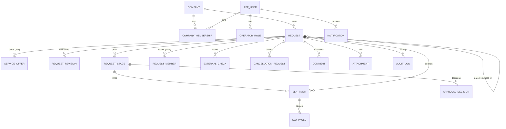

# Доменная модель

## 1. Назначение

Документ описывает сущности системы и их ключевые поля. Это вход для миграций Flyway (`core_db`), DTO в BFF и экранов интерфейса. Названия — рабочие; финальные согласуются с Кириллом и Денисом.

Основа: [roles.md](../business/roles.md), [business-process.md](../business/business-process.md), [status-model.md](status-model.md), [routing-rules.md](routing-rules.md).

## 2. Принципы

1. **Заявка и этапы — разные сущности** (по Netcracker и Salesforce). Заявка хранит параметры и статус, этапы образуют план.
2. **Всё, что участвует в логике, фильтрах, сортировке, JOIN и SLA, — обычные колонки.** JSONB — только для данных, которые читаются целиком (раздел 5).
3. **Журналы только добавляют.** `audit_log`, `request_revision`, `approval_decision`, `sla_pause`, `attachment` (версии) не редактируются и не удаляются; ошибка исправляется новой записью.
4. **Принадлежность компании — в каждой сущности заявки.** Колонка `company_id` есть у заявки и копируется в производные записи, которые запрашиваются отдельно (вложения, комментарии, аудит), чтобы изоляцию (EC-16) можно было накладывать единым фильтром.
5. **Оптимистичная блокировка** (`version`) на `request`, `request_stage`, `cancellation_request`.
6. **Мягкое удаление** только для черновика и членства в компании; остальное не удаляется.
7. **Крючки на будущее заложены в схему сразу:** `request_member`, `service_offer` (≥ 1 на заявку) и `request_revision`. Их интерфейс может появиться позже, а вот добавлять таблицы в середине проекта дороже.

## 3. ER-диаграмма (ключевые связи)

## 4. Сущности

### 4.1. Пользователи и компании

**`company`** — компания-клиент.

| Поле | Тип / значения | Комментарий |
|---|---|---|
| `id` | uuid | |
| `name`, `inn`, `kpp`, `ogrn`, `legal_address` | text | `inn` уникален среди активных (EC-15) |
| `status` | `PENDING` / `ACTIVE` / `REJECTED` | Подтверждает `ADMIN` |
| `reject_reason` | text | Обязательна при отклонении |
| `confirmed_by`, `confirmed_at` | uuid, timestamp | |

**`app_user`** — единый аккаунт платформы: `id`, `login` (уникален), `password_hash`, `full_name`, `email`, `is_active`, `created_at`. При `is_active = false` пользователь не входит в систему и не берёт этапы, но его прошлые действия и решения остаются в истории; что делать с его незакрытыми этапами — [status-model.md](status-model.md), раздел 6.5.

**`company_membership`** — связь пользователя с компанией: `id`, `company_id`, `user_id`, `added_by`, `added_at`, `removed_at` (EC-17: теряет доступ, история остаётся). Уникально `(company_id, user_id)` среди неудалённых.

**`membership_role`** — роли в компании (ManyToMany): `membership_id`, `role` (`CLIENT_OWNER` / `CLIENT_ADMIN` / `CLIENT_REQUESTER`). Роль владельца единственная на компанию.

**`operator_role`** — роли сотрудников оператора: `user_id`, `role` (`SALES_MANAGER`, `TECH_SPECIALIST`, `LAWYER`, `FINANCE_CONTROLLER`, `PROCUREMENT_SPECIALIST`, `B2B_HEAD`, `ENGINEER`, `COORDINATOR`, `ADMIN`). Создаётся сидом. Активная роль передаётся в запросе и проверяется ядром на соответствие этой таблице.

### 4.2. Заявка

**`request`**

| Группа | Поля | Комментарий |
|---|---|---|
| Идентификация | `id`, `number`, `company_id`, `created_by`, `parent_request_id` | `number` — человекочитаемый |
| Статус | `status`, `previous_status`, `status_changed_at`, `integration_error`, `commitment_level`, `request_class`, `route_version`, `version` | `previous_status` — только для `CANCEL_REQUESTED` |
| Владелец | `manager_id` | Менеджер заявки |
| Заявка клиента | `address`, `requested_speed_mbps`, `desired_date`, `contact_name`, `contact_phone`, `contract_preference`, `client_comment` | |
| Данные внешних систем | `segment`, `is_gov_customer`, `debt_amount`, `crm_manager_id` | Из mock CRM/биллинга/справочника; сырые ответы — в `external_check` |
| Результат ТВ | `tech_result`, `tech_reject_reason`, `capex`, `construction_days` | |
| Выбранное предложение | `selected_offer_id` | Ссылка на `service_offer` |
| Договор | `contract_number`, `contract_sent_at`, `contract_concluded_at` | |
| События уровней | `work_started_at`, `activated_at`, `act_sent_at`, `closed_at`, `accepted_by_default` | Из них вычисляется уровень обязательств |
| Служебное | `submitted_at`, `created_at`, `deleted_at` | `deleted_at` только для неотправленных черновиков |

**`service_offer`** — коммерческие условия заявки. В MVP у каждой заявки ровно одно предложение, оно выбирается автоматически; схема допускает несколько (клиент выбирает один из вариантов, остальные остаются для аналитики).

| Поле | Значения |
|---|---|
| `id`, `request_id`, `position` | |
| `status` | `PROPOSED` / `SELECTED` / `DECLINED` |
| `tariff_type` | `STANDARD` / `INDIVIDUAL` |
| `speed_mbps`, `discount_percent`, `price_rub`, `term_months` | |
| `contract_type` | `OFFER` / `STANDARD` / `CLIENT_FORM` |
| `attrs` | JSONB — произвольные атрибуты услуги, не участвующие в поиске |

Параметры, влияющие на маршрут (тариф, скидка, скорость, тип договора), берутся из выбранного предложения. На уникальность: не более одного `SELECTED` на заявку.

**`request_revision`** — неизменяемые снимки заявки. Создаётся при отправке, при каждой доработке и при пересборке маршрута.

| Поле | Комментарий |
|---|---|
| `id`, `request_id`, `revision_no` | `revision_no` уникален в заявке |
| `reason` | `SUBMIT` / `REWORK` / `RECALC` / `RECHECK` |
| `created_by`, `created_at` | |
| `params_snapshot` | JSONB — значения параметров целиком (читается целиком, по нему не ищем) |

**`request_member`** — доступ к конкретной заявке (**крючок, не реализуется в MVP**): `id`, `request_id`, `user_id`, `access_role` (`COLLABORATOR` / `VIEWER`), `sections` (`text[]`: `MAIN`, `COMMERCIAL`, `DOCUMENTS`, `HISTORY`), `granted_by`, `granted_at`, `revoked_at`. В MVP доступ определяется компанией и ролью, но проверка доступа в ядре сразу пишется как единая политика, которой позже можно добавить это условие.

**`external_check`** — результаты запросов к mock-сервисам: `id`, `request_id`, `system` (`CRM` / `BILLING` / `REGISTRY`), `status` (`OK` / `ERROR`), `attempts`, `checked_at`, `raw_payload` (JSONB).

### 4.3. Этапы и согласования

**`request_stage`**

| Поле | Значения |
|---|---|
| `id`, `request_id`, `route_version`, `version` | |
| `type` | См. [status-model.md](status-model.md), раздел 4.1 |
| `status` | `QUEUED` / `IN_PROGRESS` / `DONE` / `RETURNED` / `REJECTED` / `SUPERSEDED` / `CANCELLED` |
| `queue_role` | Роль очереди |
| `assignee_id` | Исполнитель (после взятия или назначения координатором) |
| `required_by_rules` | `text[]` — ID правил, из-за которых этап создан (например, `{R-03,R-05}`) |
| `created_at`, `taken_at`, `finished_at` | |

Уникальность: один неснятый этап вида `type` на `(request_id, route_version)`. Ограничение разделения обязанностей (EC-18): `assignee_id` не равен `request.manager_id` для этапов согласования; проверяется в сервисе и дублируется проверкой в БД.

**`approval_decision`** — решения согласующих (только добавляются).

| Поле | Комментарий |
|---|---|
| `id`, `stage_id`, `decided_by`, `decided_at` | |
| `decision` | `APPROVE` / `RETURN` / `REJECT` |
| `comment` | Обязателен для `RETURN` и `REJECT` |
| `scope_hash` | Хэш параметров, на которые опиралось решение (обычная колонка, по ней идёт сравнение) |
| `scope_snapshot` | JSONB — значения параметров на момент решения |
| `superseded_at` | Когда решение потеряло силу при пересборке |

### 4.4. SLA

**`sla_timer`** — таймер срока: `id`, `request_id`, `kind` (`STAGE_SLA` — норматив этапа; `DATA_CHECK_CONTROL` — контрольный срок проверки данных; `TV_CONTROL` — контрольный срок ТВ; `ACCEPTANCE` — срок приёмки; `CANCEL_RESPONSE` — ответ на запрос об отмене), `stage_id` (только для `STAGE_SLA`, иначе пусто), `norm_minutes`, `status` (`RUNNING` / `PAUSED` / `STOPPED`), `started_at`, `elapsed_sla_seconds` (время без пауз), `next_event_at` (индексируется: предупреждение или нарушение), `warned_at`, `breached_at`, `escalation_level`. Планировщик `@Scheduled` + `Clock` выбирает таймеры по `next_event_at`.

**`sla_pause`** — журнал пауз: `id`, `timer_id`, `reason_code`, `set_by` (пользователь или `SYSTEM`), `comment`, `started_at`, `ended_at`, `limit_at` (предельный срок), `extended_count`, `extended_by`. В карточке показываются два времени: по SLA и календарное.

### 4.5. Отмена

**`cancellation_request`** (и одностороннюю отмену, и по соглашению)

| Поле | Значения |
|---|---|
| `id`, `request_id`, `version` | |
| `initiator` | `CLIENT` / `OPERATOR` |
| `method` | `UNILATERAL` / `AGREEMENT` |
| `level_at_request` | 0 / 1 / 2 |
| `status` | `OPEN` / `ACCEPTED` / `WITHDRAWN` / `REJECTED` / `EXPIRED` |
| `reason_code`, `reason_comment` | Из справочника причин |
| `previous_status` | Куда вернуться при снятии запроса |
| `cost_amount` | Сумма затрат к компенсации (только уровень 2, инициатива клиента) |
| `cost_breakdown` | JSONB — расшифровка затрат (читается целиком) |
| `cost_fixed_by`, `cost_confirmed_by`, `approved_by` | Менеджер, финансовый контролёр, руководитель B2B |
| `requested_by`, `requested_at`, `resolved_at` | |

Ограничение: не более одного запроса со статусом `OPEN` на заявку.

### 4.6. Коммуникации и документы

**`comment`**: `id`, `request_id`, `company_id`, `stage_id` (опционально), `author_id`, `visibility` (`CLIENT` / `INTERNAL`), `body`, `created_at`.

**`attachment`** (версии, без перезаписи): `id`, `request_id`, `company_id`, `stage_id` (опционально), `kind` (`CONTRACT` / `ACT` / `DISAGREEMENT_PROTOCOL` / `OTHER`), `file_name`, `content_type`, `size_bytes`, `sha256`, `storage_key` (непрозрачный), `version_no`, `supersedes_id`, `uploaded_by`, `created_at`. Скачивание только через ядро с проверкой прав; каждое скачивание — запись в аудит.

### 4.7. Аудит и уведомления

**`audit_log`** — единый журнал: `id`, `created_at`, `correlation_id`, `actor_id`, `actor_role`, `company_id`, `request_id` (может быть пусто для компаний), `action`, `entity_type`, `entity_id`, `from_status`, `to_status`, `comment`, `details` (JSONB). Пользователю приложения выданы только `INSERT` и `SELECT`; миграции выполняет отдельный пользователь. В аудит попадают: смены статусов, решения, паузы SLA, отмены, изменения порогов, скачивания и экспорт, отказы в доступе (EC-16).

**`notification`** — хранимое уведомление и источник событий для WebSocket: `id`, `recipient_user_id`, `request_id`, `event_type`, `payload` (JSONB), `created_at`, `read_at`, `published_at`, `attempts`. Читается по REST («непрочитанные»); WebSocket служит сигналом, а не источником правды.

### 4.8. Справочники и настройки

| Таблица | Назначение |
|---|---|
| `routing_config` | Пороги маршрутизации ([routing-rules.md](routing-rules.md), раздел 4) |
| `sla_norm` | Нормативы SLA по типу этапа, профили `PROD` и `DEMO` (минуты) |
| `work_calendar` | Календарь профиля PROD: дата, рабочий ли день, примечание, часовой пояс |
| `pause_reason` | Закрытый справочник причин паузы: код, название, автоматическая ли, кто ставит и снимает |
| `cancel_reason` | Причины отмены с признаком стороны (клиент/оператор) |
| `idempotency_key` | Ключи идемпотентности: ключ, пользователь, хеш тела запроса, результат, срок 24 часа ([api-contract.md](api-contract.md), раздел 5.1) |
| `export_job` | Задания экспорта: автор, формат, фильтры, статус, число строк, ключ файла, срок жизни ([archive-export.md](archive-export.md)) |

## 5. JSONB: где используется и где нет

| Где | Что хранится | Почему JSONB |
|---|---|---|
| `service_offer.attrs` | Произвольные атрибуты услуги | Читаются целиком, по ним не ищем |
| `request_revision.params_snapshot` | Снимок параметров заявки | Читается целиком для показа истории |
| `approval_decision.scope_snapshot` | Параметры на момент решения | Читается целиком; сравнение идёт по `scope_hash` |
| `external_check.raw_payload` | Сырой ответ mock-сервиса | Читается целиком для разбора инцидентов |
| `cancellation_request.cost_breakdown` | Расшифровка затрат | Читается целиком |
| `audit_log.details`, `notification.payload` | Детали события | Читаются целиком |

Не JSONB (обычные колонки): всё из раздела 3 [routing-rules.md](routing-rules.md), статусы, суммы, даты, связи, `tech_result`, `capex`, уровни и роли.

Аналитические поля для поиска по архиву (статус, даты, адрес, компания, сегмент, тариф, класс заявки, итог, причина закрытия) — только колонки. Полный перечень фильтров и индексов — [archive-export.md](archive-export.md), разделы 4 и 7.

## 6. Индексы и ограничения (минимум)

- `company(inn)` уникален для активных;
- `request(company_id, status)`, `request(manager_id, status)`, `request(parent_request_id)`;
- `request_stage(queue_role, status)` — очереди; `request_stage(assignee_id, status)` — «мои задачи»;
- `sla_timer(next_event_at) WHERE status = 'RUNNING'`;
- `audit_log(request_id, created_at)`, `audit_log(company_id, created_at)`;
- `cancellation_request(request_id) WHERE status = 'OPEN'` уникален;
- `service_offer(request_id) WHERE status = 'SELECTED'` уникален;
- `notification(recipient_user_id, read_at)`.

## 7. Обязательные проверки доступа (для ревью и тестов)

Все запросы к сущностям с `company_id` проходят через единую политику доступа ядра. Чтобы её нельзя было забыть, нужен архитектурный тест (контроллер без вызова политики роняет сборку) и негативный тест на каждый эндпоинт: чужая компания, удалённый сотрудник, неверная активная роль (EC-16, EC-17, EC-18).

## 8. Допущения и открытые вопросы

| № | Вопрос | Предложение | С кем решить |
|---|---|---|---|
| 1 | Хранить ли `commitment_level` и `request_class` колонками (кэш) | Да, пересчитываются автоматом | Кирилл |
| 2 | Объединить `notification` и outbox | Принято ([architecture.md](../architecture/architecture.md), раздел 4): `published_at` + фоновая отправка; полноценный outbox при росте | Кирилл, Денис |
| 3 | Версионирование договора и акта | Через `attachment.version_no` и `supersedes_id` | Дима, Кирилл |
| 4 | Изоляция данных на уровне БД (Row-Level Security) | Опционально как второй рубеж, после основной политики в приложении | Кирилл |
| 5 | Сколько предложений в MVP | Одно, выбирается автоматически; интерфейс выбора — после | Дима, Егор |
