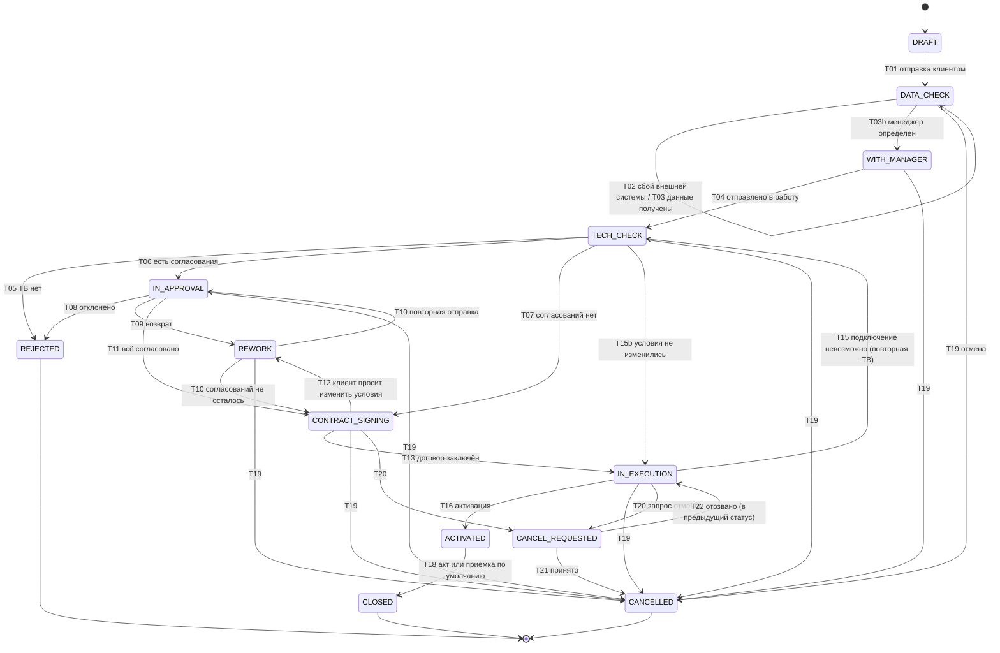

# Статусная модель

## 1. Назначение

Документ задаёт статусы заявки и этапов, допустимые переходы, роли, которые их инициируют, и побочные эффекты переходов. Это основа для конечного автомата ядра (модуль FSM Router), списка доступных действий в интерфейсе и автотестов.

Документ — вход для:
- [доменной модели](domain-model.md) — колонки статусов и журналы;
- [правил маршрутизации](routing-rules.md) — когда строится и пересобирается маршрут;
- SLA и уведомлений — на какие события они подписываются;
- QA — каждая строка таблицы переходов даёт позитивный тест, а запрещённые комбинации — негативные.

Основа: [business-process.md](../business/business-process.md), [scenarios.md](../business/scenarios.md), [roles.md](../business/roles.md). Классы состояний взяты по образцу TMF622: приём, работа, ожидание, приостановка, успешное завершение, отказ, отмена.

## 2. Принципы

1. **Два уровня.** Статус заявки (`request.status`) грубый, по фазам процесса. Подробности хода — в этапах (`request_stage`) со своими статусами.
2. **Статус хранится колонкой.** Он нужен для фильтров, очередей и SLA. Согласованность с этапами обеспечивает автомат: статус меняется только им.
3. **Один переход — одна транзакция.** Смена статуса, запись в аудит, создание/закрытие этапов, запуск и остановка SLA, запись уведомления в `notification` происходят атомарно. Внешние вызовы — до транзакции.
4. **Каждый переход проверяет роль, условие и версию.** Роль и условие проверяет ядро; версия (`request.version`) защищает от конкурентных действий. Повторное действие из уже изменённого статуса получает `409`.
5. **Терминальные статусы необратимы.** Из `CLOSED`, `REJECTED`, `CANCELLED` выхода нет. Дальнейшее — новая заявка с `parent_request_id`.
6. **Пауза SLA и уровень обязательств — не статусы.** Заявка может быть в статусе «В исполнении» и стоять на паузе; уровень обязательств вычисляется по событиям (раздел 7).
7. **Статус заявки «На согласовании» — следствие этапов.** Он наступает, когда создан хотя бы один этап согласования, и уходит, когда решения по ним приняты.

## 3. Статусы заявки

| Код | Название (UI) | Фаза | Терминальный | Смысл |
|---|---|---|---|---|
| `DRAFT` | Черновик | 1 | нет | Клиент заполняет заявку |
| `DATA_CHECK` | Проверка данных | 1 | нет | Проверка во внешних системах, назначение менеджера. Флаг `integration_error` при сбое (EC-10) |
| `WITH_MANAGER` | У менеджера | 2 | нет | Менеджер проверяет заявку, фиксирует коммерческие условия |
| `TECH_CHECK` | Проверка ТВ | 2 | нет | Технический специалист проверяет возможность (в том числе повторно, EC-22) |
| `IN_APPROVAL` | На согласовании | 3 | нет | Идут профильные и/или управленческое согласования |
| `REWORK` | На доработке | 3 | нет | Заявка возвращена менеджеру; SLA этапа на паузе |
| `CONTRACT_SIGNING` | Подписание договора | 3 | нет | Акцепт оферты клиентом или отметка менеджера о подписанном договоре |
| `IN_EXECUTION` | В исполнении | 4 | нет | Стройка, монтаж, настройка, активация |
| `ACTIVATED` | Услуга активирована | 4–5 | нет | Канал работает; ждём акт или срок приёмки; возможен этап «Устранение замечаний» |
| `CANCEL_REQUESTED` | Запрос на отмену | любая 1–4 | нет | Одна сторона запросила отмену; работы и SLA приостановлены |
| `CLOSED` | Закрыта | 5 | да | Успешный финал (акт подписан или принято по умолчанию) |
| `REJECTED` | Отклонена | 2–3 | да | Нет ТВ или согласование отклонено |
| `CANCELLED` | Отменена | 1–4 | да | Отмена односторонняя или по соглашению |

Черновик, который ещё не отправлялся оператору, клиент может **удалить** (`deleted_at`). Это не статус и не отмена.

### 3.1. Диаграмма

На диаграмме `CANCEL_REQUESTED` показан из двух статусов для наглядности: по таблице (раздел 6) запрос возможен из любого нетерминального статуса уровней 1–2, а возврат идёт в сохранённый `previous_status`.

## 4. Статусы и типы этапов

### 4.1. Типы этапов

| Код | Название | Роль очереди | Фаза |
|---|---|---|---|
| `MANAGER_REVIEW` | Рассмотрение менеджером | `SALES_MANAGER` | 1–2 |
| `TECH_CHECK` | Проверка ТВ | `TECH_SPECIALIST` | 2 |
| `RECHECK_TECH` | Повторная проверка ТВ (EC-22) | `TECH_SPECIALIST` | 4 |
| `LEGAL_APPROVAL` | Юридическое согласование | `LAWYER` | 3 |
| `FINANCE_APPROVAL` | Финансовое согласование | `FINANCE_CONTROLLER` | 3 |
| `PROCUREMENT_APPROVAL` | Закупочное согласование | `PROCUREMENT_SPECIALIST` | 3 |
| `MGMT_APPROVAL` | Управленческое согласование | `B2B_HEAD` | 3 |
| `CONTRACT_SIGNING` | Подписание договора | `SALES_MANAGER` (владелец заявки) | 3 |
| `CONSTRUCTION` | Стройка | `ENGINEER` | 4 |
| `INSTALLATION` | Монтаж и настройка | `ENGINEER` | 4 |
| `ACTIVATION` | Активация | `ENGINEER` | 4 |
| `REMEDIATION` | Устранение замечаний (EC-24) | `ENGINEER` | 5 |
| `CLOSING` | Закрытие | `SALES_MANAGER` (владелец заявки) | 5 |

### 4.2. Статусы этапа

| Код | Смысл |
|---|---|
| `QUEUED` | Создан, лежит в очереди роли; SLA идёт с этого момента |
| `IN_PROGRESS` | Взят исполнителем (или назначен координатором) |
| `DONE` | Завершён успешно (для согласования — `APPROVE`) |
| `RETURNED` | Согласующий вернул на доработку; ждёт повторного рассмотрения |
| `REJECTED` | Согласующий отклонил |
| `SUPERSEDED` | Заменён новой версией при пересборке (решение осталось в истории) |
| `CANCELLED` | Отменён: заявка завершилась, отменена или маршрут больше не требует этап |

Пауза SLA — состояние таймера (`sla_timer.status = PAUSED`), а не статус этапа.

## 5. Роли и условия: общие правила

- Переход выполняет **роль**, указанная в таблице, и только если выполнены условия.
- Системные переходы выполняет актор `SYSTEM`.
- Согласующий не может решать по своей заявке (EC-18); клиент — только по заявкам своей компании (EC-16).
- Отмена и запрос на отмену требуют причины из справочника; возврат и отклонение — обязательного комментария.

## 6. Таблица переходов

Обозначения: КЛ — `CLIENT_REQUESTER` / `CLIENT_OWNER`; МП — менеджер заявки; КООРД — координатор; РУК — руководитель B2B; ФК — финансовый контролёр; ТС, ИНЖ — технический специалист, инженер; СИС — система.

### 6.1. Основной поток

| ID | Из | Событие | В | Роль | Условие | Побочные эффекты |
|---|---|---|---|---|---|---|
| T01 | `DRAFT` | Клиент отправляет заявку | `DATA_CHECK` | КЛ | Компания `ACTIVE` (EC-14); обязательные поля и формат (EC-02); дубль только предупреждение (EC-12) | Ревизия №1; запрос во внешние системы **до транзакции**; уведомление координатору |
| T02 | `DATA_CHECK` | Внешняя система недоступна после повторов | `DATA_CHECK` | СИС | Исчерпаны попытки | `integration_error = true`; уведомление координатору; повтор — фоновой задачей или вручную (EC-10) |
| T03 | `DATA_CHECK` | Данные получены от всех трёх внешних систем | `DATA_CHECK` | СИС | Все проверки завершены успешно | Сегмент, госзаказчик, долг записываются в заявку; `integration_error = false`; контрольный срок «Проверка данных» остановлен; создаётся этап `MANAGER_REVIEW` — сразу на закреплённого в CRM менеджера или в очередь менеджеров, с этого момента по нему идёт SLA (EC-19) |
| T03b | `DATA_CHECK` | Менеджер определён | `WITH_MANAGER` | СИС / МП | Закреплённый в CRM менеджер → назначается системой; иначе МП берёт этап `MANAGER_REVIEW` из очереди (EC-19) | `manager_id` заполнен; уведомление менеджеру. Пока менеджера нет, заявка остаётся в `DATA_CHECK`, а этап ждёт в очереди |
| T04 | `WITH_MANAGER` | Менеджер отправляет в работу | `TECH_CHECK` | МП | Заполнены тариф, скидка (если индивидуальный), тип договора | Этап `MANAGER_REVIEW` завершается; предварительный маршрут (R-01…R-05, R-08); этап `TECH_CHECK` в очереди ТС; запуск SLA |
| T05 | `TECH_CHECK` | ТВ «нет» | `REJECTED` | ТС (СИС переводит) | Указана причина | Все открытые этапы `CANCELLED`; уведомление менеджеру и клиенту; возможна новая заявка с `parent_request_id` (EC-01) |
| T06 | `TECH_CHECK` | ТВ «есть» или «со стройкой» | `IN_APPROVAL` | ТС (СИС переводит) | В окончательном маршруте есть согласования | Окончательный маршрут; при стройке — CAPEX и срок; этапы волны 1 создаются **параллельно**; если волны 1 нет, а есть управленческое — создаётся `MGMT_APPROVAL` |
| T07 | `TECH_CHECK` | ТВ «есть» или «со стройкой» | `CONTRACT_SIGNING` | ТС (СИС переводит) | В маршруте нет согласований | Этап `CONTRACT_SIGNING`; клиенту показываются итоговые условия |
| T08 | `IN_APPROVAL` | Согласующий отклоняет | `REJECTED` | ЮР / ФК / ЗК / РУК | Комментарий обязателен; не менеджер этой заявки (EC-18) | Остальные открытые этапы `CANCELLED` (EC-05); уведомления участникам и клиенту |
| T09 | `IN_APPROVAL` | Согласующий возвращает | `REWORK` | ЮР / ФК / ЗК / РУК | Комментарий обязателен; статус меняется, когда в текущей волне не осталось незавершённых этапов | SLA возвращённого этапа на паузе («Возврат на доработку»); уведомление менеджеру |
| T10 | `REWORK` | Менеджер отправляет повторно | `IN_APPROVAL` или `CONTRACT_SIGNING` | МП | Данные исправлены | Новая ревизия; пересборка маршрута и сравнение снимков (routing-rules, раздел 7); возобновление SLA; если согласований не осталось — переход в `CONTRACT_SIGNING` |
| T11 | `IN_APPROVAL` | Все согласования маршрута решены | `CONTRACT_SIGNING` | СИС | Все этапы согласований `DONE`, управленческое — после профильных | Этап `CONTRACT_SIGNING` |
| T12 | `CONTRACT_SIGNING` | Клиент просит изменить условия | `REWORK` | МП | Причина зафиксирована комментарием | Пауза SLA; пересборка при отправке (T10) |
| T13 | `CONTRACT_SIGNING` | Договор заключён | `IN_EXECUTION` | КЛ (акцепт оферты) / МП (отметка о подписанном договоре) | Для договора — номер и дата | `contract_concluded_at`; **уровень 1**; создаётся первый этап исполнения: `CONSTRUCTION` (если ТВ «со стройкой») или `INSTALLATION` |
| T14 | `IN_EXECUTION` | Инженер берёт первый этап исполнения | `IN_EXECUTION` | ИНЖ | Первый раз | `work_started_at`; **уровень 2** |
| T15 | `IN_EXECUTION` | Подключение невозможно по факту (EC-22) | `TECH_CHECK` | ИНЖ сообщает, СИС переводит | Работы начаты, активации ещё нет | Этап `RECHECK_TECH`; SLA этапа исполнения на паузе |
| T15b | `TECH_CHECK` (после T15) | Результат повторной ТВ | `IN_EXECUTION`, `IN_APPROVAL` или `CONTRACT_SIGNING` | ТС | «Есть» без смены условий → `IN_EXECUTION`; условия изменились → пересборка, согласования и новое подписание → `IN_APPROVAL` / `CONTRACT_SIGNING`; «нет» → остаётся `TECH_CHECK` до запроса на отмену (T20) | Уровень обязательств **не снижается** |
| T16 | `IN_EXECUTION` | Инженер отмечает «Услуга активирована» | `ACTIVATED` | ИНЖ | Выполнены монтаж и тест | `activated_at`; **уровень 3** — отмена запрещена (EC-09); уведомление клиенту; этап `CLOSING` для менеджера |
| T17 | `ACTIVATED` | Клиент заявляет претензию | `ACTIVATED` | КЛ | Мотивированная претензия, до закрытия | Этап `REMEDIATION`; после устранения повторная отметка активации, новый срок приёмки |
| T18 | `ACTIVATED` | Акт подписан или истёк срок приёмки | `CLOSED` | МП | Акт подписан **или** истекли 5 рабочих дней без претензии (`accepted_by_default = true`) | `closed_at`; все активные таймеры остановлены; уведомление участникам |

### 6.2. Отмена

| ID | Из | Событие | В | Роль | Условие | Побочные эффекты |
|---|---|---|---|---|---|---|
| T19 | `DATA_CHECK`, `WITH_MANAGER`, `TECH_CHECK`, `IN_APPROVAL`, `REWORK`, `CONTRACT_SIGNING`, `IN_EXECUTION` | Односторонняя отмена | `CANCELLED` | См. матрицу 6.3 | Уровень и инициатор допускают одностороннюю отмену; причина обязательна | Открытые этапы `CANCELLED`; таймеры остановлены; `CancellationRequest` со способом `UNILATERAL` |
| T20 | Нетерминальные статусы уровней 1–2 | Запрос на отмену по соглашению | `CANCEL_REQUESTED` | КЛ (уровень 2) / МП (оператор, уровни 1–2) | Нет другого открытого запроса | `previous_status` сохраняется; этапы заморожены; SLA на паузе («Рассмотрение запроса на отмену»); уведомление другой стороне, менеджеру, координатору |
| T21 | `CANCEL_REQUESTED` | Условия приняты | `CANCELLED` | КЛ принимает; для инициативы оператора — после утверждения РУК | Сумма затрат подтверждена ФК (если применимо) | Этапы `CANCELLED`; решения и сумма в `CancellationRequest`; итог всем участникам |
| T21b | `CANCEL_REQUESTED` | Односторонняя отмена по объективной причине | `CANCELLED` | РУК | Причина «подключение невозможно» (EC-22); клиент не принял | Затраты клиенту не выставляются |
| T22 | `CANCEL_REQUESTED` | Запрос отозван, отклонён или истёк | `previous_status` | КЛ (отзыв, EC-21) / РУК (отклонение) / СИС (истечение) | — | Этапы и SLA возобновлены; время в запросе учтено как пауза |

❓ **Истечение запроса (T22, «истёк») — предложение.** В документах не описано, что происходит, когда сторона молчит и истекает предел паузы самого запроса на отмену (клиент не выходит на связь → менеджер просит отмену по соглашению → клиент не отвечает). Предложение: если запрос инициировал клиент — он автоматически снимается, заявка возвращается в `previous_status`, координатор уведомлён; если инициировал оператор — эскалация РУК, который либо продлевает ожидание, либо при объективной причине утверждает одностороннюю отмену (T21b).

### 6.3. Матрица отмены по уровням

| Уровень | Клиент | Оператор |
|---|---|---|
| 0 (до договора) | T19, односторонняя | Служебная T19 (КООРД): дубль, ошибка, клиент не выходит на связь (EC-12, EC-23). Отказ по процессу — это `REJECTED`, а не отмена |
| 1 (договор заключён) | T19, односторонняя, без компенсации (EC-08) | T20 по соглашению (МП → РУК → клиент); T21b только при объективной причине |
| 2 (работы начаты) | T20 по соглашению с компенсацией (EC-20) | Как на уровне 1 |
| 3 (активирована) | Запрещено (EC-09) | Запрещено |

### 6.4. Запрещённые комбинации (негативные тесты)

- Любой переход из терминального статуса.
- Любая отмена или запрос на отмену при `activated_at IS NOT NULL` (EC-09).
- `IN_APPROVAL`: решение от менеджера этой заявки (EC-18).
- Любое действие по заявке чужой компании (EC-16) или удалённого сотрудника (EC-17).
- Решение по этапу, которого нет в очереди роли пользователя или уже закрытого (ответ `409`).
- Второй открытый запрос на отмену по одной заявке.
- `T04` без заполненных коммерческих условий; `T01` для компании не в статусе `ACTIVE` (EC-14).
- Любое действие по этапу от деактивированного пользователя (раздел 6.5).

### 6.5. Недоступность исполнителя

Сотрудник оператора может быть деактивирован (`app_user.is_active = false`) или лишён роли. В отличие от EC-17, который описывает сотрудника компании-клиента, здесь речь о сотруднике оператора, и заявка не должна из-за этого встать.

| Ситуация | Что происходит |
|---|---|
| У пользователя есть этапы в `IN_PROGRESS` | Этапы **не** отменяются и не возвращаются в очередь автоматически: они помечаются признаком «требует переназначения», координатор получает уведомление и переназначает исполнителя (`POST /stages/{id}/assign`) |
| SLA таких этапов | Продолжает идти. Это организационная проблема оператора, а не ожидание клиента, поэтому причины для паузы нет — просрочка должна быть видна |
| Пользователь был менеджером заявки | Координатор переназначает менеджера ([roles.md](../business/roles.md), 8.1, п. 3); заявка остаётся в своём статусе |
| Пользователь был единственным с нужной ролью | Этап остаётся в очереди роли, работает обычный механизм EC-06: предупреждение очереди и координатору |
| Его прошлые действия и решения | Остаются в истории и в `approval_decision` без изменений; принятые решения не аннулируются |
| Он сам | Не входит в систему, не берёт этапы, не принимает решения: любое действие — `403` |

Деактивация пользователя и переназначение этапов пишутся в аудит.

## 7. Уровень обязательств

Вычисляется по событиям, не хранится как редактируемое поле (но кэшируется колонкой `commitment_level` для фильтров).

| Уровень | Условие | Событие |
|---|---|---|
| 0 | `contract_concluded_at IS NULL` | Создание заявки |
| 1 | `contract_concluded_at IS NOT NULL AND work_started_at IS NULL` | T13 |
| 2 | `work_started_at IS NOT NULL AND activated_at IS NULL` | T14 |
| 3 | `activated_at IS NOT NULL` | T16 |

Повторная ТВ (T15) и возвраты уровень не снижают. Отмена после активации невозможна независимо от статуса (в том числе во время этапа «Устранение замечаний»).

## 8. Связь с SLA

| Событие | Действие над таймером |
|---|---|
| T01 | Запуск контрольных сроков заявки: «Проверка данных» и «Результат ТВ» |
| T03 | Остановка контрольного срока «Проверка данных» |
| Этап создан (`QUEUED`) | Запуск таймера этапа |
| T09, T12 | Автопауза «Возврат на доработку» |
| T10 | Автоснятие паузы |
| «Договор отправлен» / «Акт отправлен» (отметки менеджера) | Автопауза «Ожидание подписи клиента»; снимается при T13 / T18 |
| T20 | Автопауза «Рассмотрение запроса на отмену»; снимается при T22 |
| Ручные паузы (данные от клиента, нет доступа на объект, клиент перенёс дату) | Только КООРД, с причиной из справочника |
| Этап `DONE`, `REJECTED`, `CANCELLED`, `SUPERSEDED` | Остановка таймера |
| Исполнитель деактивирован | Таймер **продолжает идти**, этап помечается требующим переназначения (раздел 6.5) |

Нормативы, пороги предупреждений и эскалации — в `sla.md`.

## 9. Допущения и открытые вопросы

| № | Вопрос | Предложение | С кем решить |
|---|---|---|---|
| 1 | Истечение запроса на отмену (T22) | Раздел 6.2 | Дима |
| 2 | Статус при повторной ТВ (T15) | `TECH_CHECK`, этап `RECHECK_TECH`, уровень не снижается | Дима |
| 3 | `REWORK` при параллельном возврате: ждать ли остальных | Да, до завершения решений волны | Дима |
| 4 | Переход T17: оставаться в `ACTIVATED` или возвращаться в `IN_EXECUTION` | Оставаться (иначе путается правило отмены) | Дима, Кирилл |
| 5 | Нужен ли статус «Принято» между `ACTIVATED` и `CLOSED` | Нет: хватает флага `accepted_by_default` | Дима |
